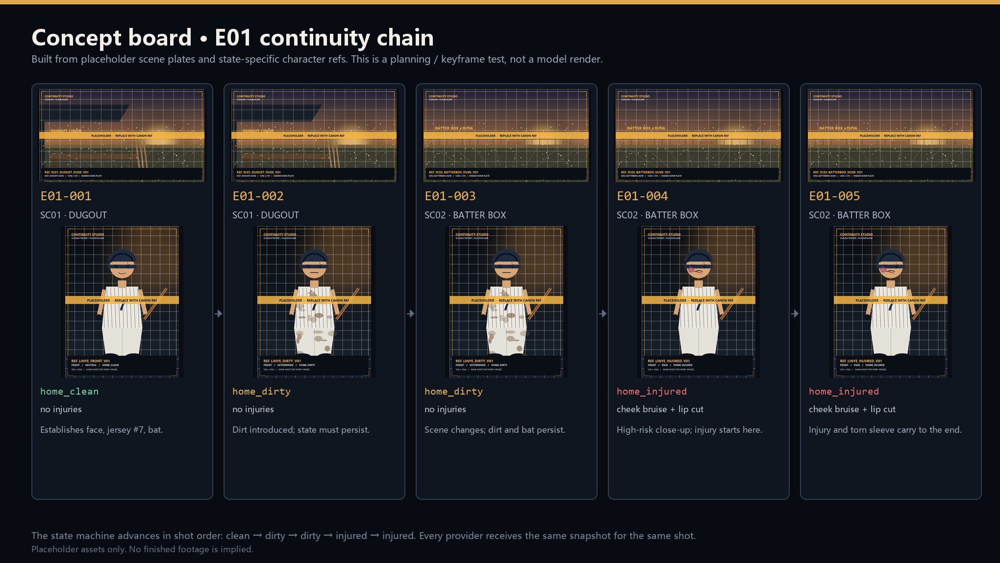
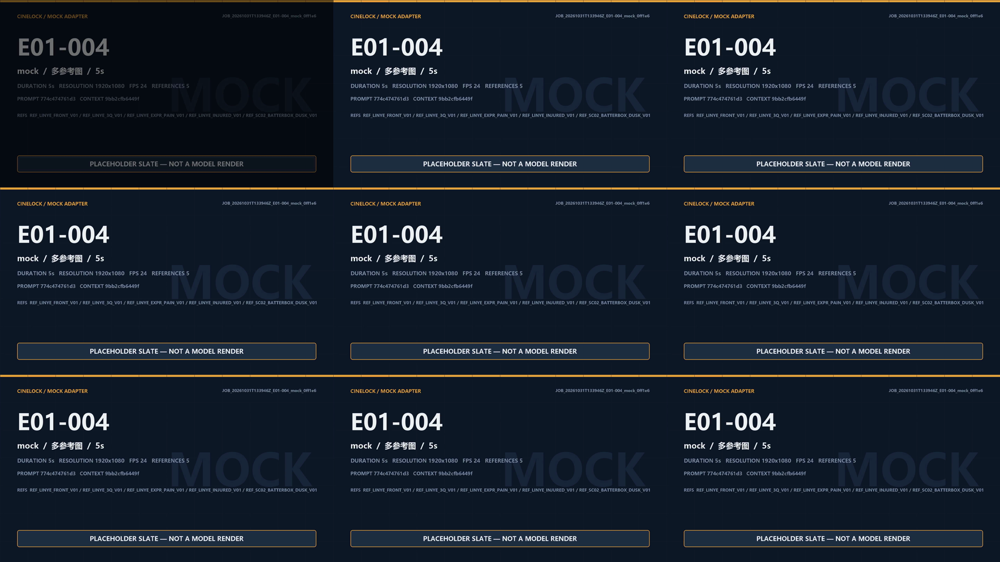
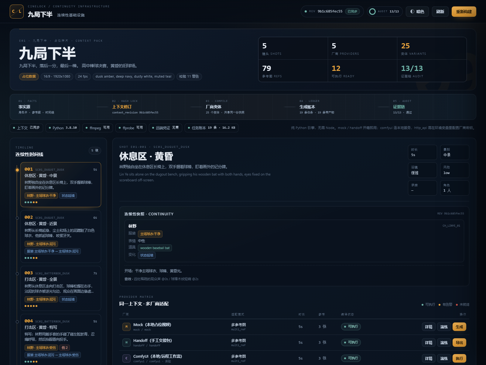
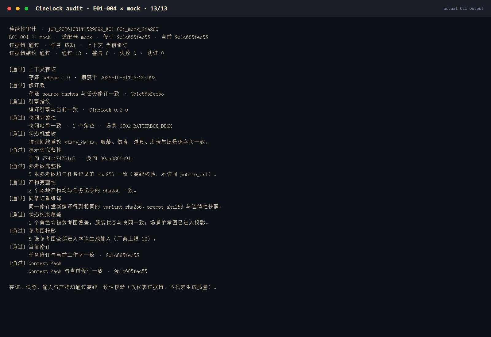
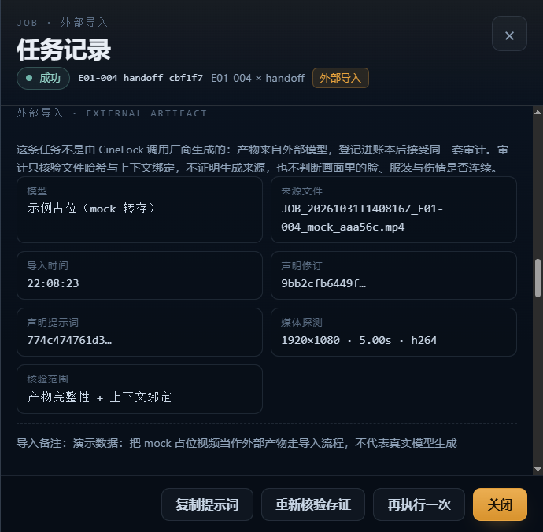
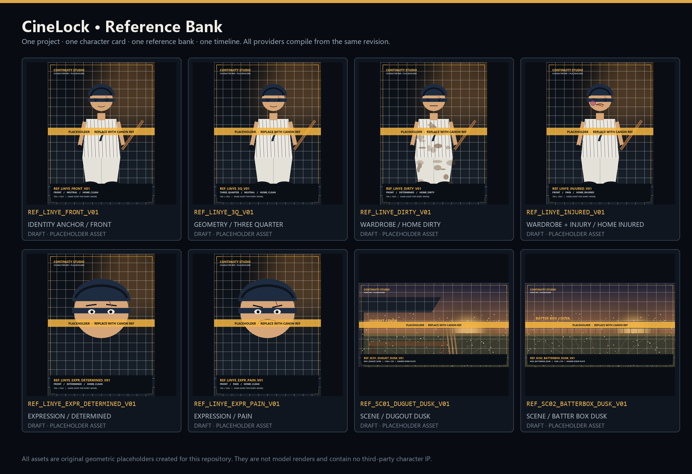

# CineLock

**A platform-agnostic context governance engine for AI video.**

[简体中文](README.md) · **English**

## Why I built this

> I only have an ASUS VivoBook. I cannot afford compute, so I can only write the most exacting code. CineLock does not generate videos for you; it protects your context. Use it to export a handoff pack and spend your web credits on generation, or connect it to ComfyUI and run local models. I built the hardest part — the architecture. The generation is up to you.

This thin-and-light laptop can handle text processing, JSON compilation, state-machine validation, and mock rendering. What it cannot do is burn hundreds or thousands of yuan searching for one usable shot. So CineLock keeps the money at the generation step and moves "don't break continuity" as far forward as possible — into compilation.

CineLock (formerly NineFlow) is a context governance engine that is independent of any specific model or platform. This repository ships *Nine Inning Bottom* as a public demo project. It is not tied to any vendor CLI and does not require Node.js: after `pip install -r requirements.txt`, the entire pipeline runs in a pure Python environment.


The central contradiction in industrializing AI video is not "can the model generate?" It is: **a probabilistic model resamples everything on every run, while filmic narrative demands absolute continuity of character, wardrobe, injuries, props, scene, and shot relationships.**

CineLock does not try to eliminate probability. It constrains uncertainty inside a lockable, reproducible, auditable context pipeline: every model shares the same reference images, the same character cards, the same timeline, and the same context revision; any change to a source of truth produces a new revision, and old packs are refused. Every generation leaves behind the prompt, reference hashes, render parameters, and output hashes, so "why did this shot change?" can be traced to a specific version.

**In one sentence: constrain the uncertainty of probabilistic models inside the continuity boundary that filmic narrative requires.**

---

## It does not generate video; it protects context

CineLock abstracts generation behind one protocol: the engine hands the compiled Context Pack, prompt, reference paths, duration, and seed to an adapter; the adapter calls a local service or a remote API, receives the video, and returns it to the engine for hashing.

Four built-in adapter types, all open interfaces, no private CLI:

| Adapter | What it does | Who it is for |
| --- | --- | --- |
| `mock` | Draws a placeholder plate locally and encodes it with ffmpeg; runs 100% of the time | Validating the pipeline, writing tests, demonstrating audit |
| `handoff` | Exports a complete context pack (JSON + images + prompts + manifest) without network access | Taking it to Midjourney / Kling / Jimeng / any web UI for manual generation |
| `comfyui` | Uploads references, submits a workflow, polls results, and downloads outputs through the ComfyUI HTTP API | People with a local GPU or a remote ComfyUI |
| `http_api` | Generic HTTP adapter with Kling / Runway presets and support for arbitrary vendors | Developers with official API keys |

**CineLock does not proxy credits, share accounts, or bypass any platform limit.** It only handles input-side consistency governance and evidence-chain auditing.

---

## 📦 Handoff: crowdsource the compute

**I do not have the money to generate the whole film, but I have packaged the context, timeline, and continuity state of *Nine Inning Bottom* on a thin-and-light laptop. Take my pack, use your own model credits, and send the result back for audit.**

Handoff is not "download a prompt". It is a verifiable handover protocol:

- The pack contains reference-image copies ordered by priority (with SHA-256), positive/negative prompts, `manifest.json`, and operating instructions.
- The manifest pins `context_revision` and `prompt_sha256`; external results must match them. An old pack cannot impersonate a new one.
- Generate keyframes in Midjourney, or generate video in Kling / Jimeng / Runway, then send the files back.
- `studio.py import` registers external video in the job ledger; **the same 13-check audit** immediately verifies that "the file has not been modified and is still bound to the same context revision".

| I bring | You bring |
| --- | --- |
| One context revision, reference order, prompts, state snapshots, audit rules | One model invocation, your membership credits |
| Hash registration and evidence-chain audit after return | A video file, or an honest failure sample |

```bash
# 1. Export a handoff pack locally, without spending any compute
python studio.py handoff --shot E01-004

# Or produce a ZIP directly:
python studio.py handoff --shot E01-004 --zip

# 2. Feed refs/ to the model in manifest order and paste prompt.txt
#    Send the generated video file back

# 3. Register the external result and audit it
python studio.py import --shot E01-004 --video ~/Downloads/kling_E01-004.mp4 \
  --model "Kling 2.5" \
  --revision <context_revision from the manifest> \
  --prompt-hash <prompt_sha256 from the manifest>
python studio.py audit --id <job_id>
```

> **Boundary**: `import` only proves that this video is bound to the current revision, prompt, and file hash. It **does not prove** that the video was actually generated by the declared model, and it **does not judge** whether faces, wardrobe, and injuries are visually continuous. Audit is an evidence chain, not a generation-source attestation, and not automatic footage review.

For your first run, read the **[Handoff step-by-step guide](docs/handoff-guide.md)** (Chinese): downloading the pack, choosing a model, matching duration, sending results back, extracting frames, importing, and auditing are all written out step by step. To sponsor compute directly, see **[Issue #11 · Sponsor a shot](https://github.com/bbo777/cinelock/issues/11)**.

---

## The problem is not generation; it is continuity

Today, the least scarce thing in AI video is "one good-looking generation". What actually makes a project spiral is these four things:

| Pain point | Industry status quo | What CineLock does |
| --- | --- | --- |
| **Inconsistent references** | Reference images are uploaded by hand for every model and every shot; versions live in people's heads | The reference bank is the single index; file hashes enter the revision lock; all variants share one `context_revision` |
| **State gets reset** | The prompt says "the uniform is dirty", yet the next shot shows a clean jersey | `state_delta` evolves in shot order; wardrobe, injuries, props, expression, and scene are fixed before compilation |
| **Prompt drift** | Every model gets a separately written description, and style and character detail drift further with each run | A deterministic compiler emits prompts in a fixed order and records `prompt_sha256` and `variant_sha256` |
| **Untraceable generations** | Only the video remains; nobody can answer which character card or reference image was used | The job ledger stores `source_hashes`, snapshots, engine fingerprint, projection, and artifact hashes, auditable offline |

Most AI video tools manage **one generation**; CineLock manages **a narrative timeline**.

It borrows two ideas from Git:

1. **Hash lock**: if content changes, the revision changes; if content does not change, the revision stays stable. An old pack cannot impersonate a new one, and a new pack cannot silently overwrite old records.
2. **State machine**: character state is not an adjective in a prompt. It is structured data that accumulates in shot order, can be replayed, and can be snapshotted.

---

## Quick start (pure Python, no Node)

### Requirements

- Python 3.8+ (verified on 3.8.10).
- Pillow: required for mock placeholder plates.
- ffmpeg / ffprobe: required for mock video encoding, contact sheets, and media validation of all locally downloaded artifacts. Without ffprobe, videos can still be downloaded, but the job carries a "media integrity not verified" warning; without ffmpeg, no video or contact sheet can be produced.
- **No Node.js and no vendor CLI.** `mock` / `handoff` work out of the box; `comfyui` connects to your own ComfyUI instance; `http_api` calls official HTTP APIs directly.

```bash
pip install -r requirements.txt
python studio.py validate
```

### Three commands to run the pipeline

```bash
python studio.py validate      # validate character cards, reference bank, timeline
python studio.py build         # compile all providers and generate the Context Pack
python studio.py serve         # open the dashboard at http://127.0.0.1:8787/
```

By default it reads `examples/nine-inning-bottom/`; use `--project-dir` to point at your own project. `serve` opens the browser automatically; add `--no-open` to disable that.

### Common CLI commands

```bash
# Inspect revisions, pack status, and provider capabilities
python studio.py status
python studio.py providers

# Inspect the compiled result and full prompt for a shot x provider
python studio.py compile --shot E01-004 --provider comfyui --prompt

# Dry run without calling any service
python studio.py run --shot E01-004 --provider mock --dry-run
python studio.py run --shot E01-004 --provider comfyui --dry-run

# Generate a local placeholder video (requires ffmpeg + Pillow)
python studio.py run --shot E01-004 --provider mock

# After a reference image is replaced, repair recorded hashes from the actual files
# (this does not change context_revision)
python studio.py refresh-hashes

# Preview one provider without writing to or overwriting the shared Context Pack
python studio.py build --provider mock

# Extract 9 frames from a job or local video into a 3x3 contact sheet
python studio.py contact-sheet --job <job_id>
python studio.py contact-sheet --video outputs/<job_id>.mp4 --out outputs/custom.png

# Export a handoff pack (folder, or folder + ZIP)
python studio.py handoff --shot E01-004
python studio.py handoff --shot E01-004 --zip

# Submit a ComfyUI workflow (use dry-run to see the plan first)
python studio.py run --shot E01-004 --provider comfyui --dry-run
python studio.py run --shot E01-004 --provider comfyui \
  --base-url http://127.0.0.1:8188 \
  --workflow config/comfyui/my-workflow.json

# Call official APIs (credentials are read from environment variables only)
python studio.py run --shot E01-001 --provider official_kling --dry-run
python studio.py run --shot E01-001 --provider official_runway --dry-run

# Register an external video produced from the same revision into the job ledger
python studio.py import --shot E01-004 --video ~/Downloads/kling_E01-004.mp4 \
  --model "Kling 2.5" --revision <manifest revision> --prompt-hash <manifest prompt hash>

# Job ledger
python studio.py jobs --limit 20
python studio.py job --id <job_id> --prompt

# Continuity audit (exit code: 0 evidence chain passes / 1 warning / 2 failure)
python studio.py audit --id <job_id>
python studio.py audit --id <job_id> --json

# Start as an MCP stdio server (Claude Desktop / WorkBuddy)
python studio.py --project-dir examples/nine-inning-bottom mcp
```

Global flags go before the subcommand, for example:

```bash
python studio.py --project-dir examples/nine-inning-bottom --config-dir config status
```

---

## MCP / API integration

CineLock includes a zero-dependency MCP stdio server. Claude Desktop, WorkBuddy, or any other MCP client can directly use the same hash lock, state machine, compiler, and audit capabilities, and can ask an agent to export handoff packs or submit ComfyUI workflows.

### 9-line config

Add the following to Claude Desktop's `claude_desktop_config.json` (on Windows: `%APPDATA%\Claude\claude_desktop_config.json`), save it, and restart the client:

```json
{
  "mcpServers": {"cinelock": {
    "command": "python",
    "args": ["C:/path/to/cinelock/studio.py", "--project-dir",
             "C:/path/to/cinelock/examples/nine-inning-bottom", "mcp"],
    "env": {"PYTHONIOENCODING": "utf-8"}
  }}
}
```

WorkBuddy uses the same block in `%USERPROFILE%\.workbuddy\mcp.json`; if the file already has other servers, merge the `cinelock` entry into `mcpServers`.

Replace `C:/path/to/cinelock` with the actual repository path. If the client cannot find `python`, use the absolute path returned by `where python`. Use `/` in Windows paths inside JSON, or escape `\` as `\\`.

### Available tools (10)

| Tool | Purpose | Writes | Network |
| --- | --- | --- | --- |
| `cinelock_status` | Current revision, shots, providers, pack status, and validation summary | No | No |
| `cinelock_validate` | Validate character cards, reference hashes, timeline, and provider config | No | No |
| `cinelock_variant` | Read the prompt, references, and continuity snapshot for a shot x `provider_id` | No (in-memory compile) | No |
| `cinelock_audit` | Run the 13-check evidence-chain audit for a `job_id` | No | No |
| `cinelock_jobs` | List the job ledger, optionally filtered by shot/provider | No | No |
| `cinelock_build` | Compile the Context Pack; preview only by default, full write with `write=true` | Only with `write=true` | No |
| `cinelock_contact_sheet` | Generate a 3x3 contact sheet from a job video | Writes to `outputs/` | No |
| `cinelock_handoff_export` | Export a handoff pack by `shot_id`; `format` can be `zip` / `folder` | Writes to `exports/` | No |
| `cinelock_generate_comfyui` | Submit a ComfyUI workflow for a `shot_id` and poll for the result | Writes to `jobs/`, `outputs/` | Yes (only the specified ComfyUI) |
| `cinelock_generate_http` | Call an official HTTP API with `shot_id` + `provider_id` | Writes to `jobs/`, `outputs/` | Yes (only the vendor API) |

Public tool names are unified as `cinelock_*`. Old `nineflow_*` names remain as compatibility aliases, but the docs, dashboard, and new configs use CineLock.

Once configured, you can simply say:

- "Audit the most recent E01-003 job and export a handoff pack."
- "Export the E01-004 handoff pack as a zip."
- "Generate E01-004 with local ComfyUI at `http://127.0.0.1:8188`; give me a dry-run plan first."
- "Generate E01-001 with `official_runway`; dry-run first."
- "Give me the full prompt and reference order for E01-004 x comfyui."

### Security boundaries

- stdio only, no listening port; read-only tools make no network requests.
- `cinelock_generate_comfyui` / `cinelock_generate_http` only connect when explicitly invoked, and only to the address given in the arguments or `providers.json`.
- The project directory is fixed at process startup; tools cannot traverse arbitrary paths.
- `cinelock_build` previews by default. Writing the shared pack requires `write=true`, which cannot be combined with `provider_id`.
- Vendor keys are read from environment variables only and never appear in configs, logs, job records, or MCP responses.
- An MCP client has the current user's local file permissions; connect trusted clients only.

---

## 🎬 Experimental project: *Nine Inning Bottom* (compute-limited; currently at keyframes and context compilation)

*Nine Inning Bottom* is not the main body of the repository. It is CineLock's **public test case**: a deliberately realistic experimental project used to verify whether the context layer can hold up when there are multiple shots, multiple providers, and continuously evolving character state.

The system does run: the character state machine is built, and the wardrobe, injuries, props, expression, and scene of all 5 shots can be replayed in timeline order. Mock rendering, handoff export, the ComfyUI adapter, external import, ffprobe validation, contact sheets, and the 13-check audit have all been verified.

But I do not have the money for the compute to produce the final footage. The timeline is currently **5 shots / 31 seconds**; I originally wanted to expand it to two and a half minutes. The reality is that I have not even finished real-model generation for these 31 seconds. **The engine already has complete context-management capabilities, but due to the author's compute limits, only keyframes, reference images, and mock placeholder videos are included. The community is welcome to continue generation using the handoff packs.**

**The repository ships mock-generated placeholder video and a real handoff pack that can be handed to someone else for generation. There is no final footage, and placeholder video will not be called final footage.**

### Current status

- The core engine, context lock, state machine, external import, and audit loop are complete; **76 tests pass**;
- **5 shots, 5 providers, 25 variants, 79 reference-image usages** share the same revision;
- Of the 25 variants, 12 have no warnings and 13 carry warnings. The warnings come from two things: E01-003's 7 seconds is rounded to the nearest supported 8 seconds by local providers; the two official APIs use a single-image first-frame path, so injury and wardrobe details beyond the identity anchor degrade to prompt descriptions, and Runway must also inline negative prompts. Every warning is recorded in its variant and is **not a hidden failure**;
- Mock rendering, handoff packs, the ComfyUI adapter, external video import, ffprobe validation, contact sheets, and the 13-check audit all work;
- Real ComfyUI workflows and the official Kling / Runway APIs remain experimental; see below;
- The repository will not call mock placeholder video final footage, nor will it call external imports "generated by CineLock".

### What it actually demonstrates

The current demo contains **1 original character, 2 scenes, and 5 shots**. The numbers are small, but the state chain is complete:

```text
E01-001  home_clean     dugout · dusk      establishes face, #7 jersey, bat
E01-002  home_dirty     dugout · dusk      mud starts here and cannot be reset later
E01-003  home_dirty     batter's box · dusk  location change; mud and bat continue
E01-004  home_injured   batter's box · dusk  bruise on left cheek, cut lower lip, torn right sleeve
E01-005  home_injured   batter's box · dusk  injuries and torn sleeve continue to the ending
```

The high-risk E01-004 is a close-up: injuries start here and must continue into the next shot. E01-005 is a wide shot: the same character state, with no unexplained reset. The prompt, reference order, projection, and snapshot for every shot x provider are compiled by CineLock from the same timeline.

### Concept board and keyframe tests



> A concept board assembled from placeholder scene boards and state reference images, used to check whether "shot order + state evolution" makes sense. **It is not model footage and does not represent the final art style.**

### Contact sheet pipeline



> A 1920x1080 3x3 contact sheet with 9 evenly sampled frames. The current video is a mock placeholder plate, used to validate the frame-extraction, review, and job-ledger pipeline. **It does not represent real model quality.**

### Local dashboard



> Revisions, timeline, continuity snapshots, provider matrix, and job ledger in one local view. The dashboard binds to `127.0.0.1` only.

### Audit 13/13



> Real CLI output: all 13 evidence-chain checks pass. Audit only proves that the job record, reference images, artifacts, and agreed revision are still consistent. **It does not prove pixel-level continuity in the footage.**

### External artifact import



> After generating with Midjourney / Kling / Jimeng from a handoff pack, use `studio.py import` to bind the file back to the current revision and prompt hash. The dashboard marks "external import", the declared revision, media probe results, and the audit boundary. The external file in the screenshot is a mock placeholder video used only to demonstrate the import flow; the screenshot was captured on a previous revision, and the UI fields match the current version.

### Reference bank



> 6 character-state images + 2 scene boards, all original geometric placeholder assets generated inside the repository, containing no third-party IP material. After replacing them with final production assets, run `build` again to generate a new context revision.

The full configuration, timeline, and `state_delta` live in [`examples/nine-inning-bottom/`](examples/nine-inning-bottom/):

```text
examples/nine-inning-bottom/
  project.json          project / style / aspect ratio / default policy
  characters.json       character cards
  reference_bank.json   reference bank
  timeline.json         scenes, shots, continuity state_delta
  refs/                 placeholder reference images
```

A historical manual handoff sample lives in [`docs/showcase/handoff-E01-004/`](docs/showcase/handoff-E01-004/); it only demonstrates the pack structure. Its revision belongs to the historical version at export time; use the pack generated after `build` as the current one. Compiled results for other shots and providers are under `context/shots/`.

---

## What it is: four layers

### 1. Context hash lock

The sources of truth (project, character cards, reference images, timeline, provider matrix, prompt maps, and engine fingerprint) together produce `context_revision`. All variants share one revision. If an inconsistency is found during a build, it fails immediately. If the context on disk has changed but the pack still records an old revision at execution time, `execute` refuses outright.

### 2. Continuity state machine

`state_delta` evolves in shot order and produces wardrobe, injury, prop, expression, and scene snapshots for each shot. All providers compile from the same snapshot; they are not allowed to maintain their own character state.

### 3. Generation ledger

Each job records the revision, prompt, reference hashes, render parameters, seed, and output hashes. Jobs additionally store `source_hashes`, integrity snapshots, engine fingerprints, and provider projection.

### 4. Provenance and audit

`audit` recomputes the revision lock, replays `state_delta`, verifies reference and artifact hashes, and recompiles with the same revision for comparison, answering "is this record still the one it was at the beginning?"

> **Boundary**: CineLock guarantees **input-side continuity and traceability**, not pixel-level identity on the output side. Models may still ignore constraints; single-reference paths (official Runway, Kling's first-frame mode) are suitable only for pipeline validation, not as consistency baselines. Output-side identity and wardrobe verification still need to be added.

### It answers three questions

- **What state should this shot be in?** `state_delta` evolves in shot order; wardrobe, injuries, props, expression, and scene are fixed before compilation.
- **Is every model receiving the same input?** All variants share one `context_revision`; when a provider truncates references, `dropped_references` is recorded instead of pretending all inputs are equal.
- **Is this record still the one it was?** `audit` recomputes the revision lock offline, replays the state machine, recompiles for comparison, and verifies reference and artifact hashes.

### Data flow

```text
sources of truth (project / character cards / reference images / timeline / provider matrix / prompt maps)
        │  file hashes + engine fingerprint
        ▼
context_revision ── build ──▶ Context Pack (all shots x providers share one revision)
        │                              │
        │                              ├─ mock / handoff / comfyui / http_api execution
        │                              ▼
        └──────────────▶ jobs/<job_id>.json (snapshot + source_hashes + artifact hashes)
                                       │
                                       ▼
                    audit (recompute revision lock / replay state_delta / recompile and compare / verify files)
```

---

## Provider matrix

The default build includes 5 providers. `mock` and `handoff` are the stable core; `comfyui` and the two official APIs are marked experimental.

| ID | Adapter | Supported modes | Reference limit | Available durations | Status |
| --- | --- | --- | --- | --- | --- |
| `mock` | `mock` | text2video / img2video / multi_ref / first_last | 10 | 3/4/5/6/8/10s | Stable |
| `handoff` | `handoff` | text2video / img2video / multi_ref / first_last | 10 | 3/4/5/6/8/10s | Stable |
| `comfyui` | `comfyui` | text2video / img2video / multi_ref / first_last | 10 | 3/4/5/6/8/10s | Experimental |
| `official_kling` | `http_api` (Kling preset) | text2video / img2video / first_last | 2 | 5/10s | Experimental |
| `official_runway` | `http_api` (Runway preset) | text2video / img2video | 1 | 5/10s | Experimental |

All providers compile prompts from the same Context Pack. Providers with a smaller `max_refs` truncate references and record `dropped_references` in the variant and audit. **We do not pretend all inputs are equal.**

### Mode selection

Selected automatically in this order:

1. A first frame and a last frame exist, and the provider supports `first_last` → first/last frames;
2. The provider supports only a single image, and a first-frame keyframe exists → single-image first frame;
3. The provider supports multiple references → multi-reference;
4. Only single-image capability → use the identity anchor as the single-image first frame, with a degradation warning;
5. Otherwise → text-to-video.

### Duration adaptation

Each variant records:

- `requested_duration_sec`: the duration required by the timeline;
- `duration_sec`: the closest duration the provider actually supports;
- `duration_choice`: `exact` / `nearest` / `truncated` / `extended`.

Adapters only pass supported durations to the API; motion detail and randomness are still decided by the model.

---

## ComfyUI integration (experimental · coming soon)

`adapters/comfyui.py` already implements the full HTTP flow: upload references → substitute workflow placeholders → submit to `/prompt` → poll `/history/{prompt_id}` → download artifacts from `/view` → ffprobe validation → record SHA-256.

The repository includes an API-format **workflow skeleton** at [`config/comfyui/workflow.example.json`](config/comfyui/workflow.example.json). It only verifies parameter injection and field wiring; **it is not a usable motion-generation workflow**. Build your own AnimateDiff / SVD / video-model graph in ComfyUI, export it in API format, and replace the skeleton.

### Placeholders

| Placeholder | Injected value |
| --- | --- |
| `__CINELOCK_PROMPT__` | Compiled positive prompt |
| `__CINELOCK_NEGATIVE__` | Negative prompt |
| `__CINELOCK_SEED__` | Variant seed |
| `__CINELOCK_DURATION__` | Requested duration (seconds) |
| `__CINELOCK_FPS__` | Frame rate |
| `__CINELOCK_WIDTH__` / `__CINELOCK_HEIGHT__` | Resolution |
| `__CINELOCK_ASPECT_RATIO__` | Aspect ratio |
| `__CINELOCK_SHOT_ID__` / `__CINELOCK_CONTEXT_REVISION__` | Shot and revision identifiers |
| `__CINELOCK_REF_N__` / `__CINELOCK_REF_N_SUBFOLDER__` | Uploaded filename and subfolder of reference N |

If any `__CINELOCK_*__` placeholder remains unresolved in the workflow, the adapter fails instead of submitting a half-wired graph.

### Usage

```bash
# 1. Start ComfyUI (default http://127.0.0.1:8188)
# 2. Inspect the plan first
python studio.py run --shot E01-004 --provider comfyui --dry-run

# 3. Replace the workflow and execute
python studio.py run --shot E01-004 --provider comfyui \
  --base-url http://127.0.0.1:8188 \
  --workflow config/comfyui/my-workflow.json \
  --timeout 900
```

You can also let an MCP agent call `cinelock_generate_comfyui`: pass `shot_id` and `base_url`, and the agent submits parameters and polls for the result.

> **Honest disclosure**: the ComfyUI adapter has only been exercised against a **simulated ComfyUI HTTP service** in tests (upload, submit, poll, download, ffprobe validation, placeholder cleanup). The author has no discrete GPU and **has not validated it on real ComfyUI with a real video model**. The sample workflow also relies on the `VHS_VideoCombine` node from `ComfyUI-VideoHelperSuite`; install that extension first.

---

## Official HTTP APIs (experimental)

`adapters/http_api.py` includes two presets and also supports fully custom vendor APIs. Keys are read from environment variables only. **Never put them in `providers.json`.**

### Kling

```bash
# Windows
set KLING_ACCESS_KEY=your-access-key
set KLING_SECRET_KEY=your-secret-key

# macOS / Linux
export KLING_ACCESS_KEY=your-access-key
export KLING_SECRET_KEY=your-secret-key
```

- The adapter generates a short-lived JWT (HS256) from the AccessKey/SecretKey, submits to `/v1/videos/text2video` or `/v1/videos/image2video`, then polls `/{task_id}` on the same path.
- Default model `kling-v1`; supports first frame and first/last frames; reference limit 2; durations 5/10 seconds; no seed.
- Endpoints and fields may change with the official documentation; without credentials, execution fails explicitly instead of faking success.

### Runway

```bash
# Windows
set RUNWAY_API_KEY=your-api-key

# macOS / Linux
export RUNWAY_API_KEY=your-api-key
```

- Uses a Bearer token + `X-Runway-Version: 2024-11-06`, submits to `/v1/text_to_video` or `/v1/image_to_video`, and polls `/v1/tasks/{id}`.
- Default model `gen3a_turbo`; single-image first frame; reference limit 1; durations 5/10 seconds.

> **Honest disclosure**: both official APIs have only been verified for dry-run plans, request construction, and the "fail explicitly when credentials are missing" path. The author has no official API keys and **has not completed a single real generation with a live account**. If fields differ from the latest official documentation, the official documentation wins; PRs to fix them are welcome.

### Custom providers

Set `adapter: "http_api"` in `config/providers.json` and use the generic fields:

- `submit_url` / `status_url`: submission and polling URLs; `status_url` supports `{task_id}`;
- `payload_template`: map your request body with variables such as `{{prompt}}` and `{{first_image}}`;
- `task_id_path` / `status_path` / `video_url_path`: extract the task ID, status, and video URL from responses;
- `api_key_env` / `auth_header` / `auth_prefix`: declare which environment variable holds the key;
- `success_values` / `failure_values`: customize state words.

The generic adapter does not guess your API; incomplete configuration fails before submission.

---

## Single source of truth

### One revision shared by all models

`context_revision` is a SHA-256 over:

- project settings and style;
- character cards;
- the reference bank (the recorded `sha256` field is replaced by the actual file hash);
- the timeline;
- the provider capability matrix (including project overrides);
- prompt maps;
- the actual file hash of every reference image;
- the engine fingerprint: CineLock version + source SHA-256 of `context.py` / `compiler.py` / `continuity.py`.

Therefore:

- Only editing the `sha256` text in a record does not create a new revision;
- Replacing image bytes, editing character cards, editing the timeline, or changing provider capabilities all create a new revision;
- Every variant records the same revision; if an inconsistency is found during a build, it fails immediately;
- If the context on disk has changed but the pack records an old revision at execution time, `execute` refuses and asks for a rebuild;
- The dashboard uses the same `status_payload`, so the CLI and UI never compute state differently.

### Replacing reference images and fixing hashes

After replacing a reference file, `validate` / `build` reports a `sha256 mismatch`. If the new image is the version you want:

```bash
python studio.py refresh-hashes
python studio.py build
```

- `refresh-hashes` recomputes the actual SHA-256 of every reference image and atomically writes it back to `reference_bank.json`;
- If any image is missing or unreadable, the entire refresh fails and writes nothing partial;
- Refresh only changes "recorded values". `context_revision` is determined by actual file hashes, so refresh itself does not create a new revision; changing image bytes does;
- `build --provider X` only compiles and prints statistics and **does not write the shared pack**. The shared `context_pack.json` is still written only by a full `build`, preventing a single-provider preview from wiping other providers' variants from the pack.

### Continuity snapshots

The timeline is the only place where character state may change:

```json
{
  "shot_id": "E01-004",
  "continuity": {
    "from_shot": "E01-003",
    "state_delta": {
      "CH_LINYE_01": {
        "wardrobe_state": "home_injured",
        "add_injuries": ["bruise on left cheek", "small cut on lower lip"]
      }
    }
  }
}
```

`continuity.py` accumulates wardrobe, injuries, and props in shot order and produces a snapshot for each shot. All providers compile from the same snapshot and are not allowed to maintain independent state.

### Reference image order

The compiler first collects references, then sorts them by character appearance order and priority, and finally truncates by the provider's `max_refs`; truncated references are recorded in `dropped_references`.

```text
shot override > identity anchor > geometry > expression
> injury > wardrobe > scene > style
```

In multi-reference mode, an identity anchor is retained for every appearing character; if the reference limit cannot cover all appearing characters, the build is blocked. Single-image providers only receive the first identity anchor (`identity_first_frame`); geometry / expression / injury degrade to prompt descriptions.

### Prompt structure

Each variant's prompt is composed of the following, in fixed order:

1. Style anchor;
2. Character description and current wardrobe/injury/props;
3. Scene, lighting, composition;
4. Shot size, camera movement, action, performance;
5. Continuity notes (previous shot and state changes);
6. Numbered reference-image legend in order;
7. Mode instruction (multi-reference / single-image first frame / text-to-video / first-last frame);
8. Quality suffix;
9. `Avoid: ...` appended when the provider does not support a separate negative field.

The negative-prompt mode is recorded as `separate` or `inline`, along with its hash.

### Provenance and audit

When a job is created, CineLock freezes its context into a recomputable provenance record:

- `provenance.source_hashes`: project, character cards, reference bank, timeline, provider matrix, prompt maps, every reference file hash, and the engine fingerprint;
- `provenance.context_snapshot` and `context_snapshot_sha256`: the wardrobe, injury, prop, expression, and scene snapshot used when compiling this shot;
- `provenance.engine`: CineLock version and source hashes of `context.py` / `compiler.py` / `continuity.py`;
- `projection`: provider `max_refs`, the number of references actually included, and truncated references;
- `outputs`: path, byte size, and SHA-256 of every local artifact.

`python studio.py audit --id <job_id>` verifies 13 items:

| # | Check | Question answered |
| --- | --- | --- |
| 1 | Context provenance | Did the job save the schema, capture time, and complete provenance? |
| 2 | Revision lock | Does the job's recorded revision equal the recomputed value from `source_hashes`? |
| 3 | Engine fingerprint | Is the compiler still the same version? Version or source changes warn; they are not treated as tampering |
| 4 | Snapshot integrity | Was the snapshot modified after creation? |
| 5 | State-machine replay | Does replaying `state_delta` on the current timeline produce the same snapshot? |
| 6 | Prompt integrity | Do the prompt and negative prompt still match the recorded hashes? |
| 7 | Reference integrity | Do local reference images still exist and match their hashes? |
| 8 | Artifact integrity | Do local videos / plates / handoff packs still match their recorded hashes? |
| 9 | Same-revision recompile | Does recompiling the same revision produce the same `variant_sha256`, `prompt_sha256`, and snapshot? |
| 10 | State constraint coverage | Is every character in the snapshot covered by references, with matching wardrobe state? |
| 11 | Reference projection | Which references did the provider limit truncate, and did every model see equal input? |
| 12 | Current revision | Is this a current job or one built on a historical revision? |
| 13 | Context Pack | Is the pack consistent with the current revision and usable for recompile comparison? |

Audit reports two things separately:

- **Evidence chain**: `status` / `artifact_status`, answering only whether the job record, references, artifacts, and agreed revision are still consistent;
- **The job itself**: `job_status` and `dry_run`, answering whether generation succeeded, failed, was blocked, or was a dry run.

`verdict.overall` then combines them: evidence chain `fail` → `fail`; evidence chain `warn`, job not successful, or context is a historical/unknown revision → `warn`; otherwise `pass`. The CLI exit code and top-level `ok` still reflect only the evidence chain, so CI can distinguish "records were tampered with" from "generation failed". A `failed` job can therefore legitimately produce "evidence chain passes, exit code 0, job status failed, overall warning". This is intentional, not a missed alert.

Evidence-chain results have three levels: `pass` (everything consistent), `warn` (old job, historical revision, engine change, or provider input boundary), `fail` (provenance, references, or artifacts were rewritten or are missing). The dashboard job drawer automatically runs the same audit and offers "re-verify".

To confirm the audit works: first run a mock job and `audit` it (all 13 should pass); then modify any reference or artifact bytes in a project copy and `audit` again. The corresponding integrity check fails and the exit code is 2.

Audit is **offline consistency verification**, not a cryptographic signature: it detects file drift, accidental edits, and naive tampering; it cannot stop someone with both job-JSON and disk write access from rewriting every hash. Remote URL artifacts and public reference images are not fetched over the network; only local copies are verified. It also does not judge whether video pixels, faces, or wardrobe are visually continuous in the footage.

---

## Directory layout

```text
studio.py                     CLI entry point
cinelock/
  context.py                  loads sources of truth, computes context_revision
  validate.py                 structure, reference, continuity, and provider validation
  continuity.py               applies state_delta in shot order and produces snapshots
  compiler.py                 reference selection, mode selection, prompt and duration adaptation
  context_pack.py             packages context_pack.json / CONTEXT.md / per-shot variants
  dispatch.py                 freshness checks, adapter dispatch, job state machine
  jobs.py                     per-job JSON + append-only jobs.jsonl + context provenance
  ingest.py                   external artifact import, revision binding, media probe
  hashes.py                   aligns recorded reference hashes with actual files (refresh-hashes)
  media.py                    ffprobe probe + ffmpeg 3x3 contact sheet
  audit.py                    revision lock, snapshot replay, reference/artifact/recompile verification
  mcp_server.py               MCP stdio server (status / compile / audit / export / generate)
  adapters/
    common.py                 unified AdapterRequest / AdapterOutcome protocol
    net.py                    zero-dependency HTTP, polling, and multipart utilities
    mock.py                   placeholder plate + ffmpeg encoding
    handoff.py                manual handoff pack (optionally zipped)
    comfyui.py                ComfyUI HTTP API (experimental)
    http_api.py               generic HTTP adapter + Kling / Runway presets
  dashboard.py                local dashboard HTTP server
  report.py                   status payload shared by CLI and dashboard
  cli.py / environment.py
config/
  providers.json              platform-agnostic provider capability matrix
  prompt_maps.json            style, shot-size, camera-movement vocabulary
  comfyui/workflow.example.json  API-format ComfyUI workflow skeleton
web/                          dependency-free dashboard frontend
examples/nine-inning-bottom/  experimental project *Nine Inning Bottom*
  project.json                project/style/aspect ratio/default policy
  characters.json             character cards
  reference_bank.json         reference bank (local paths + optional public_url)
  timeline.json               scenes, shots, continuity state_delta
  refs/                       original geometric placeholder references
  context/                    build output (including a prebuilt Context Pack)
  jobs/ outputs/ exports/     job ledger, videos, handoff packs (runtime, gitignored)
legacy/
  quota_flow.py               archived old adapter; not in the build, imported by nothing
tests/                        unittest suite
```

`legacy/` exists only to preserve historical code. It is **not in the adapter registry and is never loaded by the default build**. The active engine is pure Python with no Node probing and no CLI subprocesses.

---

## Verified capabilities

- `python -m unittest discover -s tests -p "test_*.py" -v`: **76 tests pass**.
- Mock adapter: really generates a 5s / 1920x1080 / 24fps H.264 placeholder video (Pillow plate + ffmpeg), then reads back duration, resolution, and codec with ffprobe.
- Media module: ffprobe validates local video; ffmpeg samples 9 frames evenly into a 1920x1080 3x3 contact sheet.
- Handoff adapter: exports a complete manual pack with references, positive/negative prompts, manifest, and README, optionally zipped.
- External import: `import` binds an external model video to the current revision and prompt hash, copies it into `outputs/`, records SHA-256 and ffprobe metadata, and runs the same 13-check audit; mismatched revisions or prompts are rejected.
- ComfyUI adapter: upload → submit → poll → download → ffprobe → SHA-256 recorded against a simulated ComfyUI HTTP service in tests; leftover placeholders block submission.
- Official API adapters: dry-run plans, request construction, and explicit failure when credentials are missing; **no real-account generation records**.
- Continuity audit: jobs store context snapshots and engine fingerprints; both CLI and dashboard verify 13 checks individually — revision lock, snapshot integrity, state-machine replay, prompts, references, artifact hashes, same-revision recompile, and detection of old jobs and historical revisions. Results separate **evidence-chain status** from **job status**, so "job failed" is no longer misreported as "provenance failed".
- Hash closure: `refresh-hashes` repairs recorded hashes of replaced references from the actual files; only a full `build` writes the shared pack, while `build --provider` is preview-only.
- Local dashboard: timeline, continuity snapshots, provider matrix, variant drawer, job ledger, audit drawer, video preview, one-click contact sheet inside the job drawer, and mock generation from the UI; includes light/dark theme switching, a top evidence-chain ring, and a context-pipeline diagram. Verified on desktop and a 390px narrow viewport.
- MCP server: 10 tools (status / validate / variant / audit / jobs / build / contact sheet / handoff export / ComfyUI generate / HTTP generate), `nineflow_*` compatibility aliases, stdio round trips, and tool errors returned as results.
- Security: Host/Origin validation, custom POST header, file-root allowlist, Range 206, CSP; the pure Python engine has no Node dependency.

**Unverified / current limitations**:

- Generation on real ComfyUI with a real video model (the author has no discrete GPU; only a simulated service has been tested).
- Real generation through the official Kling / Runway APIs (the author has no API keys; only plans and failure paths have been verified).
- Output-side visual continuity (faces, wardrobe, injuries, props) still requires human or vision-model review.

---

## Tests

```bash
python -m unittest discover -s tests -p "test_*.py" -v
```

Coverage:

- Revision stability and invalidation;
- Continuity state evolution;
- Reference limits, identity anchors, mode selection, duration adaptation, prompt content, and determinism;
- Real mock rendering, handoff packs and ZIP, the full simulated ComfyUI flow, explicit official-API failure without credentials, external video import with revision/prompt binding, and rejection of stale packs;
- Default provider matrix, adapter mapping, single-provider preview, and shared-pack protection;
- Audit pass, snapshot/revision/reference/artifact tampering, historical revisions, legacy-job downgrade, job-status vs evidence-chain layering, audit API and CLI;
- Dashboard API, CSRF/Host/Origin, path traversal, file Range, contact-sheet endpoint, and local-video preconditions;
- Full CLI paths for validate / build / status / compile / run / handoff / jobs / job / audit / refresh-hashes / contact-sheet;
- Hash-drift repair, refusal to write when references are missing, and cleanup of stale variant files during rebuild;
- ffprobe probing, 3x3 contact-sheet dimensions and timestamps, and bad-video errors;
- MCP initialization, 10-tool catalog, read-only status/variant, preview without writing the pack, handoff export (ZIP/folder), ComfyUI/HTTP dry-run, compatibility aliases, and stdio round trips.

Mock rendering and contact-sheet tests skip automatically when ffmpeg / ffprobe / Pillow are missing.

---

## Turn the demo into your own project

*Nine Inning Bottom* is deliberately built as a **reusable template**. After forking, you do not need to change engine code:

```bash
cp -r examples/nine-inning-bottom projects/my-story
python studio.py --project-dir projects/my-story validate
python studio.py --project-dir projects/my-story build
python studio.py --project-dir projects/my-story serve
```

Then replace, in order:

1. **Characters**: edit `characters.json`, filling in `descriptor`, identity invariants, wardrobe states, expression references, and negative prompts.
2. **Reference images**: put real images in `refs/` and update `asset_id`, `path`, and `status` in `reference_bank.json`; `build` computes actual hashes automatically and writes them into the pack. `public_url` is optional and needed only for `http_api`'s URL mode; it must be public https.
3. **Timeline**: edit scenes, shots, dialogue, sound effects, and `state_delta` in `timeline.json`. State changes go only here.
4. **Providers**: adjust `config/providers.json` to real capabilities; project-level overrides go in `provider_overrides` in `project.json`.
5. **Rebuild**: `validate && build`. Old packs are invalidated automatically, and the dashboard shows "context has changed".

The repository keeps a prebuilt `context/context_pack.json` for browsing the dashboard directly; after changing any source of truth, you must rebuild.

### Recruiting the community to finish it

The next phase of *Nine Inning Bottom* is not "write another demo"; it is to actually generate the 5 shots and add output-side continuity verification. Contributions are welcome in these directions:

- Use handoff packs to generate E01-001 through E01-005 on models you know, and return job records and failure samples;
- If you have a GPU, run a real ComfyUI workflow and contribute a non-placeholder workflow example;
- If you have official API keys, validate the Kling / Runway presets and correct fields;
- Replace placeholder references and contribute character/scene assets with clear authorization;
- Add output-side review: visual verification of faces, wardrobe, injuries, and props;
- Integrate new providers or MCP clients;
- Extend the timeline: more characters, more scenes, more state branches.

Full task breakdowns, acceptance criteria, reporting formats, and ready-to-paste issue drafts are in [`docs/community-tasks.md`](docs/community-tasks.md) (Chinese).

- Task issues: [bbo777/cinelock/issues](https://github.com/bbo777/cinelock/issues)
- Project board: [Nine Inning Bottom](https://github.com/users/bbo777/projects/5)

Shot 06 ("bat-planting display") and Shot 07 ("training montage") are currently **proposals only**. They do not exist in the timeline and have no compiled prompts; design `state_delta` first, then `build`.

Before submitting, confirm: no Cookie / API key / login state; assets are properly licensed; do not label mock placeholder video as real footage.

---

## Design boundaries and consistency limits

- **Consistency is probabilistic**: the same references and snapshots significantly reduce drift, but cannot guarantee pixel-level consistency across models.
- Single-image providers lose geometry, expression, and injury references, leaving only the identity anchor and text description — the drift-prone path.
- Official Runway accepts 1 reference and Kling 2, both effectively single-image first frame; injury and wardrobe references degrade to prompt descriptions. Multi-reference paths (mock / handoff / comfyui) allow 10; if exceeded, `dropped_references` is recorded in the variant and audit. **We do not pretend inputs are equal.**
- The ComfyUI adapter is experimental; the sample workflow is only a wiring skeleton, not a usable motion-generation workflow.
- The Kling / Runway presets are experimental and have not been validated with real accounts; endpoints and fields may change with official documentation.
- Official API duration, motion detail, and randomness are decided by the vendor.
- First/last-frame mode is enabled only when the timeline provides `keyframes.first` / `keyframes.last`; the placeholder data has no keyframes.
- There is currently no automatic face scoring, shot-completion judgment, audio/lip-sync, automatic retry, or human review queue.
- ffprobe only verifies container, video stream, duration, and resolution; it cannot prove faces, wardrobe, or injuries are continuous. The contact sheet is an aid for human review, not automatic QA.
- Mock output is only a placeholder plate and cannot be used to judge real model quality.
- `import` accepts only local `.mp4` / `.mov` / `.webm` and verifies only "file hash + current revision/prompt binding"; it does not validate generation source, judge visual continuity, or download remote links automatically.
- Audit can prove "the job record and the reference images/artifacts currently on disk are still consistent"; it cannot prove faces, wardrobe, and injuries in the footage are actually continuous. Output-side human or vision-model review is still required.
- Audit is not a cryptographic signature; it guards against drift and naive tampering only. Someone with write access to both job JSON and disk can rewrite provenance and artifacts together.
- The dashboard is a single-machine tool with no multi-user authentication and should not be exposed to a LAN or the public internet.

---

## Naming and versions

- `CineLock` is the official name starting with 0.2.0; `NineFlow` remains as the 0.1.x development codename and historical tag.
- The Python package name, CLI, MCP server, and tool names are all unified as `cinelock` / `cinelock_*`; old `nineflow_*` names exist only as compatibility aliases.
- Old repository URLs redirect via GitHub; if your scripts hardcode `bbo777/nineflow`, change them to `bbo777/cinelock`.

---

## Security and compliance

- The dashboard binds to `127.0.0.1` by default, validates Host/Origin, requires `X-CineLock: studio` on POST, can read only `refs/`, `outputs/`, and `exports/`, and blocks path traversal.
- Vendor API keys / AccessKey / SecretKey are read from environment variables only and are never written to `providers.json`, job records, logs, or MCP responses.
- Context Packs and handoff packs contain only prompts, reference copies, and metadata; they contain no Cookie, API key, or login state.
- Public reference images must be uploaded by you, and you must confirm access permissions. Check copyright, portrait authorization, and privacy before uploading.
- Follow each vendor's terms of service and quota rules for real generation. This project only performs continuity orchestration, dispatch, and audit; it does not bypass quotas or provide account sharing or risk-control evasion.
- Rights and authorization for characters, scripts, and reference images are the user's responsibility.
- This repository contains no third-party IP material; the characters, scenes, and references in the example are original placeholder content.

---

## Copyright and disclaimer

The characters, script, and reference images in the example project *Nine Inning Bottom* are original placeholder content, used only to demonstrate the engine's complex state-machine capabilities. Do not use them commercially. This repository currently contains no third-party IP material. Users must ensure they have legal rights to any assets they upload and bear responsibility for any rights defects.

CineLock performs input-side continuity governance and evidence-chain auditing only. It makes no guarantee regarding the authenticity, legality, or visual quality of any model-generated content.

---

If you happen to have spare model memberships, a GPU, or compute, you are welcome to claim a shot at [Issue #11 · Sponsor a shot](https://github.com/bbo777/cinelock/issues/11). If you have no budget either, you are welcome to Star the project, pick up an engineering task, or fork it and actually generate the 5 shots of *Nine Inning Bottom*. **Money or effort, either helps; CineLock keeps the context in order.**
