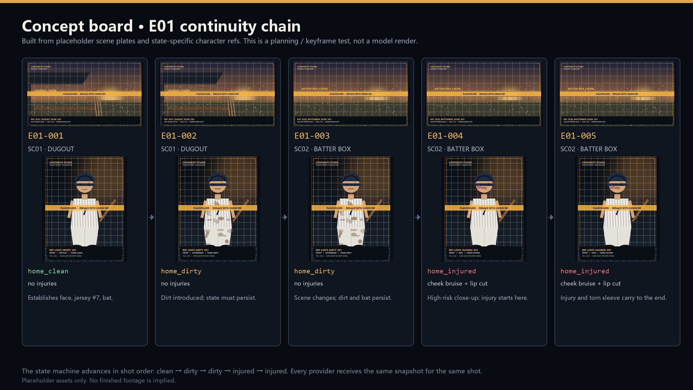
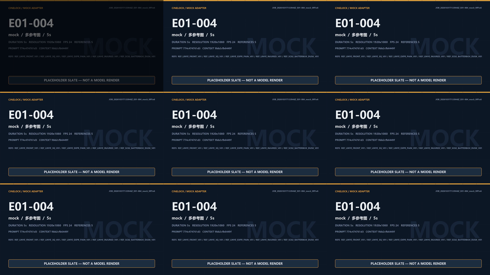
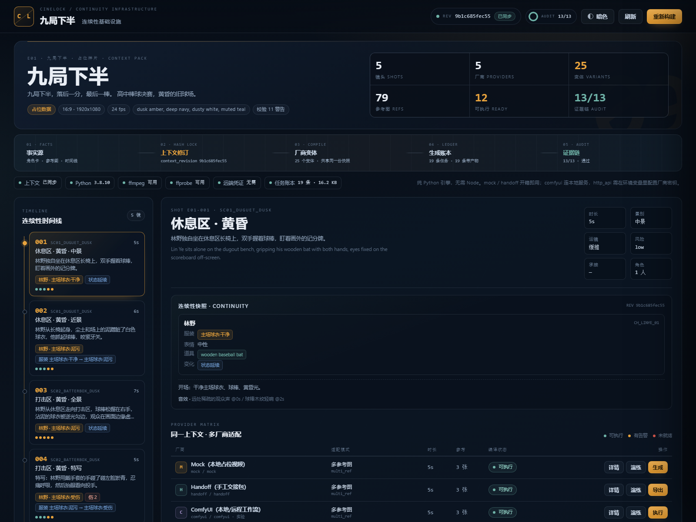
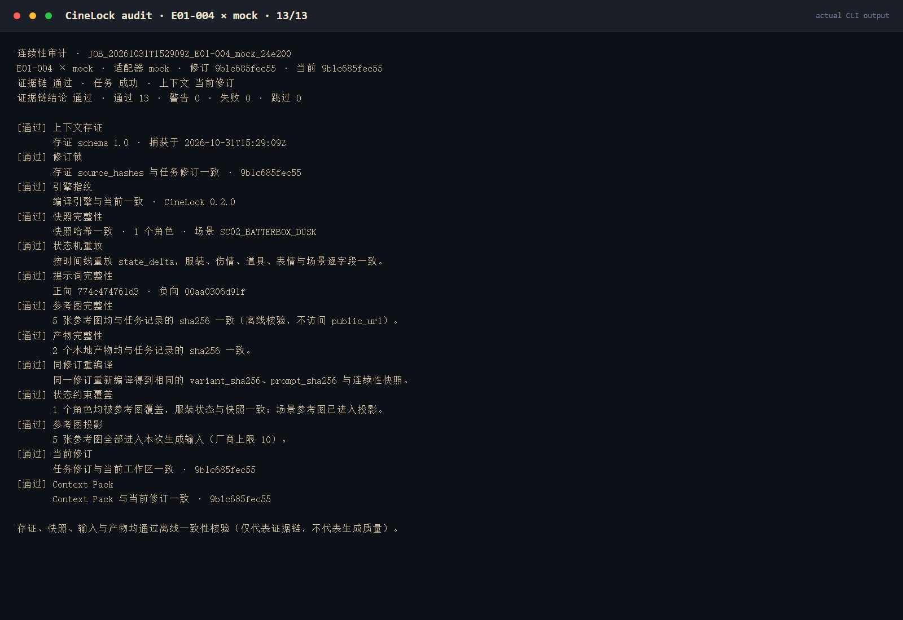
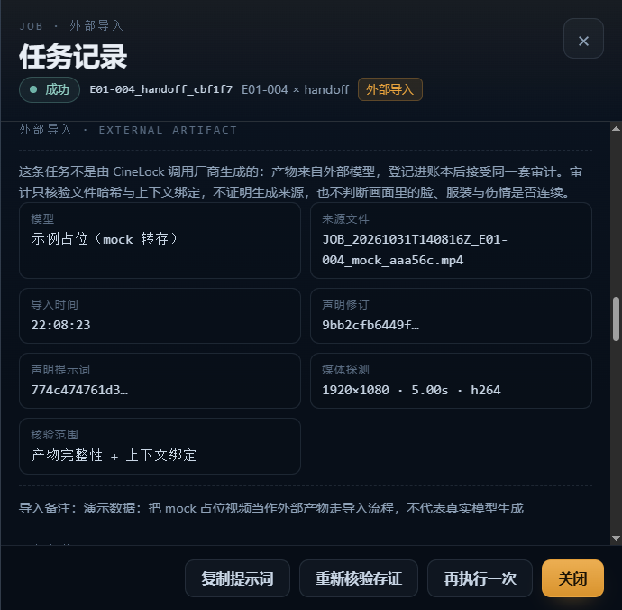
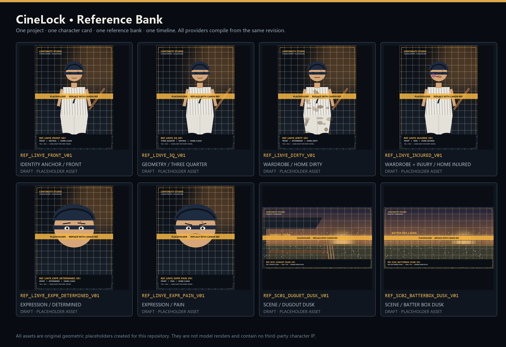

# CineLock

**一个平台无关的 AI 视频上下文治理引擎（Context Governance Engine for AI Video）。**

## Why I built this（我的开发动机）

> 我只有一台 ASUS VivoBook，买不起算力，只能写极致的代码。CineLock 不负责帮你生成视频，它负责帮你守住上下文。你可以用它导出交接包（Handoff）去白嫖网页端额度，也可以接入 ComfyUI 跑本地模型。我完成了最难的架构，剩下的生成交给你自己。

这台轻薄本能做文字处理、JSON 编译、状态机校验和 mock 渲染；它做不了的，是替你烧掉几百上千块去抽一条能用的镜头。所以 CineLock 把“钱”留在生成那一步，把“不穿帮”尽量前移到编译那一步。

CineLock（原 NineFlow）是一个与具体模型、具体平台无关的上下文治理引擎。本仓库自带《九局下半》作为公开演示项目。它不绑定任何一家厂商的 CLI，也不要求你安装 Node.js：`pip install -r requirements.txt` 之后，纯 Python 环境就能跑通整条链路。


AI 视频工业化最核心的矛盾，不是“模型会不会生成”，而是：**概率模型每次都在重新采样，影视叙事却要求角色、服装、伤情、道具、场景和镜头关系绝对连续。**

CineLock 不试图消除概率性，而是把不确定性约束进一条可锁定、可复现、可审计的上下文流水线：每个模型共享同一套参考图、同一份角色卡、同一条时间线和同一个上下文修订；任何事实源变化都会生成新修订，旧包拒绝执行。每次生成都会留下提示词、参考图哈希、渲染参数和输出哈希，让“这一镜为什么变了”可以追到具体版本。

**一句话：把概率模型的不确定性，约束进影视叙事要求的连续性边界内。**

---

## 它不生成视频，它守住上下文

CineLock 把“生成”抽象成一个统一协议：引擎只负责把编译好的 Context Pack、提示词、参考图路径、时长和 seed 交给适配器；适配器负责调用本地服务或远端 API，拿到视频后交还给引擎记录哈希。

内置四种执行方式，全部是开放接口，不依赖某个私有 CLI：

| 适配器 | 做什么 | 适合谁 |
| --- | --- | --- |
| `mock` | 本地绘制占位底板并用 ffmpeg 编码，100% 可跑 | 验证全链路、写测试、演示审计 |
| `handoff` | 导出完整的上下文包（JSON + 图片 + 提示词 + manifest），不联网 | 拿去 Midjourney / 可灵 / 即梦 / 任意网页端手动生成 |
| `comfyui` | 通过 ComfyUI HTTP API 上传参考图、提交工作流、轮询结果、下载产物 | 有本地显卡或远程 ComfyUI 的人 |
| `http_api` | 通用 HTTP 适配器，内置可灵 / Runway 预设，也可配置任意厂商 | 有官方 API Key 的开发者 |

**CineLock 不代理额度、不共享账号、不绕过任何平台限制。** 它只做输入侧的一致性治理与证据链审计。

---

## 📦 Handoff：把算力众包出去

**我没有钱生成全片，但我用一台轻薄本把《九局下半》的上下文、时间线、连续状态完整打包了。你可以拿着我的包，用你自己的模型额度生成，再把结果传回来审计。**

Handoff 不是“下载一段提示词”，而是一份可验证的交接协议：

- 包里有按优先级排好的参考图副本（附 SHA-256）、正向/负向提示词、`manifest.json` 和操作说明；
- manifest 固定 `context_revision` 与 `prompt_sha256`，外部结果必须对得上，不能拿旧包冒充新包；
- 你在 Midjourney 生成关键帧，或去可灵 / 即梦 / Runway 生成视频，再把文件传回来；
- `studio.py import` 把外部视频登记进任务账本，**同一套 13 项审计**立刻能核验“文件没被动过、仍然绑在同一个上下文修订上”。

| 我出 | 你出 |
| --- | --- |
| 一个上下文修订、参考图顺序、提示词、状态快照、审计规则 | 一次模型调用、你的会员额度 |
| 回传后的哈希登记与证据链审计 | 视频文件，或者一份诚实的失败样本 |

```bash
# 1. 导出交接包（本机，不花一分钱算力）
python studio.py handoff --shot E01-004

# 需要直接发一个压缩包：
python studio.py handoff --shot E01-004 --zip

# 2. 把 refs/ 里的图按 manifest 顺序喂给模型，粘贴 prompt.txt
#    生成后把视频文件发回来

# 3. 登记外部结果并审计
python studio.py import --shot E01-004 --video ~/Downloads/kling_E01-004.mp4 \
  --model "Kling 2.5" \
  --revision <manifest 里的 context_revision> \
  --prompt-hash <manifest 里的 prompt_sha256>
python studio.py audit --id <job_id>
```

> **边界**：`import` 只证明这条视频与当前修订、提示词和文件哈希绑定一致；它**不证明**视频真的由所声明的模型生成，也**不判断**画面里的脸、服装与伤情是否连续。审计是证据链，不是生成来源鉴定，更不是自动审片。

第一次操作请直接看 **[Handoff 傻瓜式操作指南](docs/handoff-guide.md)**：从下载包、选模型、对齐时长，到回传、抽帧、导入、审计，全部按步骤写死。想直接赞助算力，见 **[Issue #11 · 求大佬赞助算力](https://github.com/bbo777/cinelock/issues/11)**。

---

## 问题不在生成，而在连续性

今天做 AI 视频，最不缺的是“生成一次好看的画面”。真正让项目失控的是下面四件事：

| 痛点 | 行业现状 | CineLock 的做法 |
| --- | --- | --- |
| **参考不一致** | 每个模型、每个镜头手工上传参考图，版本全靠人记 | 参考图库是唯一索引，文件哈希进入修订锁；所有变体共享同一个 `context_revision` |
| **状态被重置** | 提示词里写“衣服脏了”，下一镜模型又给一件干净球衣 | `state_delta` 按镜头顺序演化，编译前就确定服装、伤情、道具、表情与场景 |
| **提示词漂移** | 每个模型各写一套描述，风格和角色细节越跑越偏 | 确定性编译器按固定顺序生成提示词，记录 `prompt_sha256` 与 `variant_sha256` |
| **生成不可追溯** | 最后只剩视频，无法回答当时用了哪版角色卡、哪张参考图 | 任务账本保存 `source_hashes`、快照、引擎指纹、投影与产物哈希，可离线审计 |

大多数 AI 视频工具管理的是**一次生成**；CineLock 管理的是**一条叙事时间线**。

它借用了 Git 的两个思路：

1. **哈希锁**：内容变了，修订号就变；内容没变，修订号就稳定。旧包不能冒充新包，新包也不能悄悄覆盖旧记录。
2. **状态机**：角色状态不是提示词里的形容词，而是按镜头顺序累积、可重放、可快照的结构化数据。

---

## 快速开始（纯 Python，无 Node）

### 环境

- Python 3.8+（已在 3.8.10 验证）。
- Pillow：mock 占位底板需要。
- ffmpeg / ffprobe：mock 视频编码、九宫格抽帧、所有本地下载产物的媒体校验需要。缺少 ffprobe 时仍能下载视频，但任务会带“未做媒体完整性校验”的警告；缺少 ffmpeg 时无法出片或生成九宫格。
- **不需要 Node.js，也不需要安装任何厂商 CLI。** `mock` / `handoff` 开箱即用；`comfyui` 连你自己启动的 ComfyUI；`http_api` 直接调官方 HTTP 接口。

```bash
pip install -r requirements.txt
python studio.py validate
```

### 三条命令跑通

```bash
python studio.py validate      # 校验角色卡、参考图库、时间线
python studio.py build         # 编译全部厂商，生成 Context Pack
python studio.py serve         # 打开看板 http://127.0.0.1:8787/
```

默认读取 `examples/nine-inning-bottom/`；也可以用 `--project-dir` 指向你自己的项目。`serve` 默认自动打开浏览器，加 `--no-open` 可关闭。

### CLI 常用命令

```bash
# 查看修订、包状态、厂商能力
python studio.py status
python studio.py providers

# 查看某个镜头 × 厂商的编译结果与完整提示词
python studio.py compile --shot E01-004 --provider comfyui --prompt

# 只演练，不调用任何服务
python studio.py run --shot E01-004 --provider mock --dry-run
python studio.py run --shot E01-004 --provider comfyui --dry-run

# 生成本地占位视频（需要 ffmpeg + Pillow）
python studio.py run --shot E01-004 --provider mock

# 参考图被替换后，按实际文件修复记录哈希（不会改变 context_revision）
python studio.py refresh-hashes

# 只预览某个厂商，不写入、不覆盖共享 Context Pack
python studio.py build --provider mock

# 从任务或本地视频抽 9 帧拼成 3×3 九宫格
python studio.py contact-sheet --job <job_id>
python studio.py contact-sheet --video outputs/<job_id>.mp4 --out outputs/custom.png

# 导出交接包（文件夹，或文件夹 + ZIP）
python studio.py handoff --shot E01-004
python studio.py handoff --shot E01-004 --zip

# 提交 ComfyUI 工作流（先用 dry-run 看计划）
python studio.py run --shot E01-004 --provider comfyui --dry-run
python studio.py run --shot E01-004 --provider comfyui \
  --base-url http://127.0.0.1:8188 \
  --workflow config/comfyui/my-workflow.json

# 调用官方 API（凭证只从环境变量读取）
python studio.py run --shot E01-001 --provider official_kling --dry-run
python studio.py run --shot E01-001 --provider official_runway --dry-run

# 把外部模型生成、且属于同一修订的视频登记进任务账本
python studio.py import --shot E01-004 --video ~/Downloads/kling_E01-004.mp4 \
  --model "Kling 2.5" --revision <manifest 修订> --prompt-hash <manifest 提示词哈希>

# 任务账本
python studio.py jobs --limit 20
python studio.py job --id <job_id> --prompt

# 连续性审计（退出码：0 证据链通过 / 1 警告 / 2 失败）
python studio.py audit --id <job_id>
python studio.py audit --id <job_id> --json

# 以 MCP stdio Server 启动（Claude Desktop / WorkBuddy）
python studio.py --project-dir examples/nine-inning-bottom mcp
```

全局参数放在子命令之前，例如：

```bash
python studio.py --project-dir examples/nine-inning-bottom --config-dir config status
```

---

## MCP / API 接入

CineLock 内置一个零依赖的 MCP stdio Server。Claude Desktop、WorkBuddy 或其他 MCP 客户端可以直接调用同一套哈希锁、状态机、编译与审计能力，也可以让 Agent 导出交接包或提交 ComfyUI 工作流。

### 9 行配置

把下面这段加入 Claude Desktop 的 `claude_desktop_config.json`（Windows 路径：`%APPDATA%\Claude\claude_desktop_config.json`），保存后重启客户端：

```json
{
  "mcpServers": {"cinelock": {
    "command": "python",
    "args": ["C:/path/to/cinelock/studio.py", "--project-dir",
             "C:/path/to/cinelock/examples/nine-inning-bottom", "mcp"],
    "env": {"PYTHONIOENCODING": "utf-8"}
  }}
}
```

WorkBuddy 使用同一段配置，写入 `%USERPROFILE%\.workbuddy\mcp.json`；如果文件里已有其他 server，把 `cinelock` 这一项合并进 `mcpServers` 即可。

把 `C:/path/to/cinelock` 换成仓库实际路径。若客户端找不到 `python`，把 `"command"` 换成 `where python` 返回的绝对路径。JSON 里的 Windows 路径请使用 `/`，或把 `\` 转义为 `\\`。

### 可用工具（10 个）

| 工具 | 作用 | 写入 | 联网 |
| --- | --- | --- | --- |
| `cinelock_status` | 当前修订、镜头、厂商、Pack 状态与校验摘要 | 否 | 否 |
| `cinelock_validate` | 校验角色卡、参考图哈希、时间线与厂商配置 | 否 | 否 |
| `cinelock_variant` | 读取某个镜头 × `provider_id` 的提示词、参考图与连续性快照 | 否（仅内存编译） | 否 |
| `cinelock_audit` | 按 `job_id` 运行 13 项证据链审计 | 否 | 否 |
| `cinelock_jobs` | 列出任务账本，可按镜头/厂商过滤 | 否 | 否 |
| `cinelock_build` | 编译 Context Pack；默认只预览，`write=true` 才全量写入 | 显式传 `write=true` | 否 |
| `cinelock_contact_sheet` | 从任务视频生成 3×3 抽帧九宫格 | 写入 `outputs/` | 否 |
| `cinelock_handoff_export` | 按 `shot_id` 导出交接包，`format` 可选 `zip` / `folder` | 写入 `exports/` | 否 |
| `cinelock_generate_comfyui` | 按 `shot_id` 提交 ComfyUI 工作流并轮询结果 | 写入 `jobs/`、`outputs/` | 是（只连指定 ComfyUI） |
| `cinelock_generate_http` | 按 `shot_id` + `provider_id` 调用官方 HTTP API | 写入 `jobs/`、`outputs/` | 是（只连厂商 API） |

公共工具名已统一为 `cinelock_*`。旧的 `nineflow_*` 名称保留为兼容别名，但文档、看板和新配置一律使用 CineLock。

配置完成后，可以直接在客户端里说：

- “帮我审计一下最近生成的 E01-003 任务，并导出一份 handoff 包。”
- “把 E01-004 的交接包导出成 zip。”
- “用本地 ComfyUI 生成 E01-004，地址是 `http://127.0.0.1:8188`，先 dry-run 给我看计划。”
- “用 `official_runway` 生成 E01-001，先 dry-run。”
- “把 E01-004 × comfyui 的完整提示词和参考图顺序给我。”

### 安全边界

- 只使用 stdio，不监听端口；只读工具不发起网络请求。
- `cinelock_generate_comfyui` / `cinelock_generate_http` 只有在你显式调用时才联网，且只连接参数或 `providers.json` 指定的地址。
- 项目目录在进程启动时固定，工具不能遍历到任意路径。
- `cinelock_build` 默认只预览，写共享包必须显式传 `write=true`，且不允许和 `provider_id` 同时使用。
- 厂商密钥只从环境变量读取，不会出现在配置、日志、任务记录或 MCP 返回值里。
- MCP 客户端拥有当前用户的本地文件权限，只连接可信客户端。

---

## 🎬 实验项目：《九局下半》（因算力受限，目前停留在关键帧与上下文编译阶段）

《九局下半》不是仓库的主体，而是 CineLock 的**公开测试用例**：一个刻意保留真实复杂度的实验项目，用来验证“多镜头、多厂商、角色状态持续演化”时，上下文层能不能兜住。

这套系统是跑通的：角色状态机建好了，5 个镜头的服装、伤情、道具、表情与场景都能按时间线重放；mock 出片、handoff 导出、ComfyUI 适配器、外部导入、ffprobe 校验、九宫格抽帧、13 项审计都已验证。

但我没钱买算力把成片跑出来。时间线目前是 **5 个镜头 / 31 秒**，我原本想把它扩到 2 分半；现实是连这 31 秒的真实模型出片都还没跑完。**引擎已具备完整的上下文管理能力，但因作者算力受限，目前仅保留了关键帧、参考图与 mock 占位视频，欢迎社区使用 Handoff 包接力生成。**

**目前仓库附带的是 mock 产出的占位视频，以及一份可以直接交给别人去生成的真实 handoff 包。没有成片，也不会把占位视频说成成片。**

### 当前状态

- 系统底层引擎、上下文锁、状态机、外部导入与审计闭环已完成，**76 项测试通过**；
- **5 个镜头、5 个厂商、25 个变体、79 次参考图引用**共享同一个修订；
- 25 个变体中 12 个无告警、13 个带告警；告警来自两件事：E01-003 的 7 秒被本地厂商就近调整为 8 秒；两家官方 API 走单图首帧路径，除身份锚点外的伤情与服装细节退化为提示词描述，Runway 还需把负向词内联。所有告警都记录在变体里，**不是隐藏失败**；
- mock 出片、handoff 包、ComfyUI 适配器、外部视频导入、ffprobe 校验、九宫格抽帧、13 项审计均已跑通；
- 真实 ComfyUI 工作流与可灵 / Runway 官方 API 仍属实验性，详见下文；
- 仓库不会把 mock 占位视频说成成片，也不会把外部导入说成“由 CineLock 生成”。

### 它到底在演示什么

当前演示包含 **1 个原创角色、2 个场景、5 个镜头**。数量不大，但状态链是完整的：

```text
E01-001  home_clean    休息区 · 黄昏    建立脸、7 号球衣、球棒
E01-002  home_dirty    休息区 · 黄昏    泥污从这里开始，后续不能重置
E01-003  home_dirty    打击区 · 黄昏    空间转换，泥污与球棒继续
E01-004  home_injured  打击区 · 黄昏    左脸淤青、下唇破口、右袖撕裂
E01-005  home_injured  打击区 · 黄昏    伤情与撕裂袖口延续到收尾
```

高风险的 E01-004 是特写：伤情从这里开始，下一镜必须延续；E01-005 是大远景：同一套角色状态，不做无解释重置。每个镜头 × 每个厂商的提示词、参考图顺序、投影和快照，都由 CineLock 从同一份时间线编译。

### 概念板与关键帧测试



> 由占位场景板与状态参考图拼出的概念板，用来检查“镜头顺序 + 状态演化”是否讲得通。**它不是模型成片，也不代表最终画风。**

### 九宫格抽帧管线



> 1920×1080、9 帧均匀采样的 3×3 九宫格。当前视频是 mock 占位底板，用来验证抽帧、审片和任务账本链路，**不代表真实模型质量**。

### 本地看板



> 修订、时间线、连续性快照、厂商矩阵与任务账本在同一个本地视图里。看板只绑定 `127.0.0.1`。

### 审计 13/13



> 真实 CLI 输出：证据链 13 项通过。审计只证明任务记录、参考图、产物与约定修订仍然一致，**不证明成片里的像素级连续性**。

### 外部产物导入



> 拿着 handoff 包去 Midjourney / 可灵 / 即梦生成后，用 `studio.py import` 把文件绑回当前修订与提示词哈希。看板会标出“外部导入”、声明修订、媒体探测结果和审计边界。图中的外部文件是 mock 占位视频，仅用于演示导入流程；截图摄于上一修订，界面字段与当前版本一致。

### 参考图库



> 6 张角色状态图 + 2 张场景板，全部是仓库内生成的原创几何占位资产，不包含任何第三方 IP 素材。替换为正式设定后，重新 `build` 即可生成新的上下文修订。

项目的完整配置、时间线和 `state_delta` 在 [`examples/nine-inning-bottom/`](examples/nine-inning-bottom/)：

```text
examples/nine-inning-bottom/
  project.json          项目 / 风格 / 画幅 / 默认策略
  characters.json       角色卡
  reference_bank.json   参考图库
  timeline.json         场景、镜头、连续性 state_delta
  refs/                 占位参考图
```

历史手工交接包样例在 [`docs/showcase/handoff-E01-004/`](docs/showcase/handoff-E01-004/)，仅用于展示包结构；其中的修订号属于导出时的历史版本，当前应以 `build` 后生成的包为准。其余镜头与厂商的编译结果在 `context/shots/` 下。

---

## 它是什么：四层机制

### 1. 上下文哈希锁

事实源（项目、角色卡、参考图、时间线、厂商矩阵、提示词词表、编译引擎指纹）共同生成 `context_revision`。所有变体共享一个修订；构建时若发现不一致直接失败；执行前若发现磁盘上的上下文已变化、包内还是旧修订，`execute` 直接拒绝。

### 2. 连续性状态机

`state_delta` 按镜头顺序演化，生成每个镜头的服装、伤情、道具、表情与场景快照。所有厂商从同一份快照编译，不允许各自维护角色状态。

### 3. 生成账本

每个任务记录修订、提示词、参考图哈希、渲染参数、seed 与输出哈希。任务额外保存 `source_hashes`、完整性快照、引擎指纹与厂商投影。

### 4. 存证与审计

`audit` 重算修订锁、重放 `state_delta`、核验参考图和产物哈希，并用同一修订重编译比对，回答“这份记录还是不是当初那一份”。

> **边界**：CineLock 保证的是**输入侧连续性与可追溯性**，不是输出侧像素级一致。模型仍可能忽略约束；单参考路径（官方 Runway、Kling 的首帧模式）只适合链路验证，不作为一致性基线。输出侧的身份/服装核验仍需补。

### 它回答三个问题

- **这一镜应该是什么状态？** `state_delta` 按镜头顺序演化，编译前就确定服装、伤情、道具、表情与场景。
- **每个模型拿到的是不是同一份输入？** 所有变体共享一个 `context_revision`；厂商截断参考图时会记录 `dropped_references`，不假装各家输入相等。
- **这份记录还是不是当初那一份？** `audit` 离线重算修订锁、重放状态机、重编译比对，并核验参考图与产物哈希。

### 数据流

```text
事实源（项目 / 角色卡 / 参考图 / 时间线 / 厂商矩阵 / 词表）
        │  文件哈希 + 引擎指纹
        ▼
context_revision ── build ──▶ Context Pack（所有镜头 × 厂商共享同一修订）
        │                              │
        │                              ├─ mock / handoff / comfyui / http_api 执行
        │                              ▼
        └──────────────▶ jobs/<job_id>.json（快照 + source_hashes + 产物哈希）
                                       │
                                       ▼
                    audit（重算修订锁 / 重放 state_delta / 重编译比对 / 核验文件）
```

---

## Provider 矩阵

默认 build 包含 5 家。`mock` 与 `handoff` 是稳定核心；`comfyui` 与两家官方 API 标注为实验性。

| ID | 适配器 | 支持模式 | 参考上限 | 可选时长 | 状态 |
| --- | --- | --- | --- | --- | --- |
| `mock` | `mock` | text2video / img2video / multi_ref / first_last | 10 | 3/4/5/6/8/10s | 稳定 |
| `handoff` | `handoff` | text2video / img2video / multi_ref / first_last | 10 | 3/4/5/6/8/10s | 稳定 |
| `comfyui` | `comfyui` | text2video / img2video / multi_ref / first_last | 10 | 3/4/5/6/8/10s | 实验性 |
| `official_kling` | `http_api`（Kling 预设） | text2video / img2video / first_last | 2 | 5/10s | 实验性 |
| `official_runway` | `http_api`（Runway 预设） | text2video / img2video | 1 | 5/10s | 实验性 |

所有厂商的提示词都从同一份 Context Pack 编译；`max_refs` 较小的厂商会截断参考图，并在变体与审计里记录 `dropped_references`。**不假装各家输入相等。**

### 模式选择

按以下顺序自动选择：

1. 有首帧和尾帧，且厂商支持 `first_last` → 首尾帧；
2. 厂商只支持单图，且存在首帧关键帧 → 单图首帧；
3. 厂商支持多参考 → 多参考图；
4. 只有单图能力 → 拿身份锚点做单图首帧，并给出降级警告；
5. 其余 → 文生视频。

### 时长适配

每个变体记录：

- `requested_duration_sec`：时间线要求的时长；
- `duration_sec`：该厂商实际可选的最接近值；
- `duration_choice`：`exact` / `nearest` / `truncated` / `extended`。

适配器只把厂商支持的时长传给接口；最终运动细节与随机性仍由模型决定。

---

## 接入 ComfyUI（experimental · 即将支持）

`adapters/comfyui.py` 已经实现完整 HTTP 流程：上传参考图 → 替换工作流占位符 → 提交 `/prompt` → 轮询 `/history/{prompt_id}` → 下载 `/view` 产物 → ffprobe 校验 → 记录 SHA-256。

仓库附带一个 API 格式的**工作流骨架** [`config/comfyui/workflow.example.json`](config/comfyui/workflow.example.json)。它只用来验证参数注入和字段接线，**不是可用的运动生成工作流**——请在 ComfyUI 里搭好你自己的 AnimateDiff / SVD / 视频模型节点图，导出 API 格式后替换它。

### 占位符

| 占位符 | 注入内容 |
| --- | --- |
| `__CINELOCK_PROMPT__` | 编译后的正向提示词 |
| `__CINELOCK_NEGATIVE__` | 负向提示词 |
| `__CINELOCK_SEED__` | 变体 seed |
| `__CINELOCK_DURATION__` | 请求时长（秒） |
| `__CINELOCK_FPS__` | 帧率 |
| `__CINELOCK_WIDTH__` / `__CINELOCK_HEIGHT__` | 分辨率 |
| `__CINELOCK_ASPECT_RATIO__` | 画幅 |
| `__CINELOCK_SHOT_ID__` / `__CINELOCK_CONTEXT_REVISION__` | 镜头与修订标识 |
| `__CINELOCK_REF_N__` / `__CINELOCK_REF_N_SUBFOLDER__` | 第 N 张参考图上传后的文件名与子目录 |

工作流里如果残留未替换的 `__CINELOCK_*__` 占位符，适配器会直接失败，不会把半成品提交给模型。

### 使用

```bash
# 1. 启动 ComfyUI（默认 http://127.0.0.1:8188）
# 2. 先看计划
python studio.py run --shot E01-004 --provider comfyui --dry-run

# 3. 换成你的工作流后执行
python studio.py run --shot E01-004 --provider comfyui \
  --base-url http://127.0.0.1:8188 \
  --workflow config/comfyui/my-workflow.json \
  --timeout 900
```

也可以让 MCP Agent 调用 `cinelock_generate_comfyui`：传入 `shot_id` 和 `base_url`，Agent 会提交参数并轮询结果。

> **诚实标注**：ComfyUI 适配器目前只在测试里对**模拟的 ComfyUI HTTP 服务**跑通过（上传、提交、轮询、下载、ffprobe 校验、占位符清理）。作者没有独立显卡，**尚未在真实 ComfyUI + 真实视频模型上验收**。示例工作流还会用到 `ComfyUI-VideoHelperSuite` 的 `VHS_VideoCombine` 节点，请先安装对应插件。

---

## 接入官方 HTTP API（experimental）

`adapters/http_api.py` 内置两个预设，也支持完全自定义的厂商接口。密钥只从环境变量读取，**不要写进 `providers.json`**。

### 可灵（Kling）

```bash
# Windows
set KLING_ACCESS_KEY=your-access-key
set KLING_SECRET_KEY=your-secret-key

# macOS / Linux
export KLING_ACCESS_KEY=your-access-key
export KLING_SECRET_KEY=your-secret-key
```

- 适配器用 AccessKey/SecretKey 生成短期 JWT（HS256），提交 `/v1/videos/text2video` 或 `/v1/videos/image2video`，再轮询同一路径下的 `/{task_id}`。
- 默认模型 `kling-v1`，支持首帧与首尾帧，参考上限 2 张，时长 5/10 秒，不支持 seed。
- 端点与字段可能随官方文档变化；没有凭证时执行会明确失败，不会伪造成功。

### Runway

```bash
# Windows
set RUNWAY_API_KEY=your-api-key

# macOS / Linux
export RUNWAY_API_KEY=your-api-key
```

- 使用 Bearer Token + `X-Runway-Version: 2024-11-06`，提交 `/v1/text_to_video` 或 `/v1/image_to_video`，轮询 `/v1/tasks/{id}`。
- 默认模型 `gen3a_turbo`，单图首帧，参考上限 1 张，时长 5/10 秒。

> **诚实标注**：两家官方 API 目前只验证了 dry-run 计划、请求构造与“缺少凭证时明确失败”的路径。作者没有官方 API Key，**没有用真实账号跑通过一次出片**。字段若与官方最新文档不一致，以官方文档为准，欢迎提 PR 修正。

### 自定义厂商

在 `config/providers.json` 里配置 `adapter: "http_api"`，并使用通用字段：

- `submit_url` / `status_url`：提交与轮询地址，`status_url` 支持 `{task_id}`；
- `payload_template`：用 `{{prompt}}`、`{{first_image}}` 等变量映射你的请求体；
- `task_id_path` / `status_path` / `video_url_path`：从响应里提取任务 ID、状态和视频地址；
- `api_key_env` / `auth_header` / `auth_prefix`：声明密钥所在环境变量；
- `success_values` / `failure_values`：自定义状态词。

通用适配器不会猜测你的接口；配置不全时会在提交前失败。

---

## 唯一事实源

### 一个修订，所有模型共用

`context_revision` 是对以下内容计算的 SHA-256：

- 项目设定与风格；
- 角色卡；
- 参考图库（记录中的 `sha256` 字段会被实际文件哈希替换）；
- 时间线；
- 厂商能力矩阵（含项目覆盖项）；
- 提示词词表；
- 每个参考图的实际文件哈希；
- 编译引擎指纹：CineLock 版本 + `context.py` / `compiler.py` / `continuity.py` 的源码 SHA-256。

因此：

- 只更新记录里的 `sha256` 文本，不会产生新修订；
- 替换图片字节、改角色卡、改时间线、改厂商能力，都会产生新修订；
- 每个变体都记录同一个修订；构建时若发现不一致，直接失败；
- 执行前若发现磁盘上的上下文已变化、包内还是旧修订，`execute` 直接拒绝，提示重新 `build`；
- 看板用同一个 `status_payload`，CLI 与 UI 不会各算一套状态。

### 参考图换了，哈希怎么修

替换参考图文件后，`validate` / `build` 会报告 `sha256 不匹配`。如果新图是你要的版本：

```bash
python studio.py refresh-hashes
python studio.py build
```

- `refresh-hashes` 会重新计算每张参考图的实际 SHA-256，并原子写回 `reference_bank.json`；
- 任何一张图缺失或不可读，整次刷新直接失败，不写入部分结果；
- 刷新只改“记录值”。`context_revision` 由实际文件哈希决定，所以刷新本身不产生新修订，真正改变修订的是图片字节；
- `build --provider X` 只编译并打印统计，**不写入共享包**；共享 `context_pack.json` 仍然只由全量 `build` 写入，避免一次单厂商预览把其他厂商的变体从包里抹掉。

### 连续性快照

时间线是唯一允许修改角色状态的地方：

```json
{
  "shot_id": "E01-004",
  "continuity": {
    "from_shot": "E01-003",
    "state_delta": {
      "CH_LINYE_01": {
        "wardrobe_state": "home_injured",
        "add_injuries": ["bruise on left cheek", "small cut on lower lip"]
      }
    }
  }
}
```

`continuity.py` 按镜头顺序累积服装、伤情和道具，生成每个镜头的快照。所有厂商都从同一份快照编译，不允许各自维护状态。

### 参考图顺序

编译器先收集参考图，再按角色出现顺序与优先级排序，最后按厂商 `max_refs` 截断；被截断的参考图记入 `dropped_references`。

```text
镜头覆盖 override > 身份锚点 identity > 几何 geometry > 表情 expression
> 伤情 injury > 服装 wardrobe > 场景 scene > 风格 style
```

多参考模式下会为每个出场角色保留身份锚点；参考上限不足以容纳所有出场角色时直接阻断。单图厂商只能拿到第 1 张身份锚点（`identity_first_frame`），geometry / expression / injury 会退化为提示词描述。

### 提示词结构

每个变体的提示词由以下部分组成，顺序固定：

1. 风格锚点；
2. 角色描述与当前服装/伤情/道具；
3. 场景、光线、构图；
4. 景别、运镜、动作、表演；
5. 连续性说明（承接镜头与状态变化）；
6. 按顺序编号的参考图图例；
7. 模式指令（多参考 / 单图首帧 / 文生 / 首尾帧）；
8. 质量后缀；
9. 厂商不支持独立负向词时，追加 `Avoid: ...`。

负向词模式会记录为 `separate` 或 `inline`，并同时保存哈希。

### 连续性存证与审计

任务创建时，CineLock 会把当时的上下文固化成一份可重算的存证：

- `provenance.source_hashes`：项目、角色卡、参考图库、时间线、厂商矩阵、提示词词表、每个参考图文件哈希与引擎指纹；
- `provenance.context_snapshot` 与 `context_snapshot_sha256`：这一镜编译时使用的服装、伤情、道具、表情与场景快照；
- `provenance.engine`：CineLock 版本与 `context.py` / `compiler.py` / `continuity.py` 的源码哈希；
- `projection`：厂商 `max_refs`、实际进入的参考图数量、被截断的参考图；
- `outputs`：每个本地产物的路径、字节数与 SHA-256。

`python studio.py audit --id <job_id>` 会逐项核验 13 项：

| # | 检查 | 回答的问题 |
| --- | --- | --- |
| 1 | 上下文存证 | 任务是否保存了 schema、捕获时间与完整存证 |
| 2 | 修订锁 | 任务记录的修订号，是否等于 `source_hashes` 的重算值 |
| 3 | 引擎指纹 | 编译引擎是否仍是当初那一版；版本或源码变化只警告，不判篡改 |
| 4 | 快照完整性 | 快照是否在创建后被改写 |
| 5 | 状态机重放 | 按当前时间线重跑 `state_delta`，是否得到同一份快照 |
| 6 | 提示词完整性 | 提示词与负向词是否仍匹配记录的哈希 |
| 7 | 参考图完整性 | 本地参考图是否仍存在、哈希是否一致 |
| 8 | 产物完整性 | 本地视频 / 底板 / 交接包是否仍匹配记录的哈希 |
| 9 | 同修订重编译 | 同一修订重新编译，`variant_sha256`、`prompt_sha256` 与快照是否一致 |
| 10 | 状态约束覆盖 | 快照里的每个角色，是否都被参考图覆盖且服装状态一致 |
| 11 | 参考图投影 | 厂商上限截断了哪些参考图，各模型实际看到的输入是否相等 |
| 12 | 当前修订 | 这是当前任务，还是基于历史修订 |
| 13 | Context Pack | 包是否与当前修订一致，能否用于重编译比对 |

审计把两件事拆开报告：

- **证据链**：`status` / `artifact_status`，只回答任务记录、参考图、产物与约定修订是否仍然一致；
- **任务本身**：`job_status` 与 `dry_run`，回答生成是成功、失败、阻断还是演练。

`verdict.overall` 再合成二者：证据链 `fail` → `fail`；证据链 `warn`、任务非成功、或上下文是历史/未知修订 → `warn`；其余 `pass`。CLI 退出码和顶层 `ok` 仍只看证据链，方便 CI 区分“记录被篡改”与“生成失败”。因此一个 `failed` 任务完全可以得到“证据链通过、退出码 0、任务状态失败、overall 警告”的组合，这是有意设计，不是漏报。

证据链结论分三档：`pass`（全部一致）、`warn`（旧任务、历史修订、引擎变化或厂商输入边界）、`fail`（存证、参考图或产物被改写或缺失）。看板任务抽屉会自动运行同一套审计，并提供“重新核验”。

想确认审计确实在工作：先跑一个 mock 任务并 `audit`（应为 13 项通过）；再在项目副本里改动任意参考图或产物字节，重新 `audit`，对应完整性检查会变成失败，退出码为 2。

审计是**离线一致性核验**，不是密码学签名：它能发现文件漂移、误改和朴素篡改；对同时拥有任务 JSON 与磁盘写权限的人，无法阻止其重写全部哈希。远程 URL 产物与公网参考图不做联网抓取，只核验本地副本。它也不判断视频像素、人脸或服装在成片里是否真的连续。

---

## 目录

```text
studio.py                     CLI 入口
cinelock/
  context.py                  加载事实源，计算 context_revision
  validate.py                 结构、引用、连续性、厂商能力校验
  continuity.py               按镜头顺序应用 state_delta，生成快照
  compiler.py                 参考图选择、模式选择、提示词与时长适配
  context_pack.py             打包 context_pack.json / CONTEXT.md / 分镜变体
  dispatch.py                 新鲜度检查、适配器调度、任务状态机
  jobs.py                     单个任务 JSON + append-only jobs.jsonl + 上下文存证
  ingest.py                   外部模型产物导入、修订绑定与媒体探测
  hashes.py                   参考图记录哈希与实际文件对齐（refresh-hashes）
  media.py                    ffprobe 探测 + ffmpeg 抽帧九宫格
  audit.py                    修订锁、快照重放、参考图/产物/重编译核验
  mcp_server.py               MCP stdio Server（状态 / 编译 / 审计 / 导出 / 生成）
  adapters/
    common.py                 统一 AdapterRequest / AdapterOutcome 协议
    net.py                    零依赖 HTTP、轮询与 multipart 工具
    mock.py                   占位底板 + ffmpeg 编码
    handoff.py                手工交接包（可打包 ZIP）
    comfyui.py                ComfyUI HTTP API（实验性）
    http_api.py               通用 HTTP 适配器 + Kling / Runway 预设
  dashboard.py                本地看板 HTTP 服务
  report.py                   CLI 与看板共用的状态载荷
  cli.py / environment.py
config/
  providers.json              平台无关厂商能力矩阵
  prompt_maps.json            风格、景别、运镜等词表
  comfyui/workflow.example.json  ComfyUI API 格式工作流骨架
web/                          无外部依赖的看板前端
examples/nine-inning-bottom/  实验项目《九局下半》
  project.json                项目/风格/画幅/默认策略
  characters.json             角色卡
  reference_bank.json         参考图库（本地路径 + 可选 public_url）
  timeline.json               场景、镜头、连续性 state_delta
  refs/                       原创几何占位参考图
  context/                    构建产物（含预构建的 Context Pack）
  jobs/ outputs/ exports/     任务账本、视频、交接包（运行时生成，已 gitignore）
legacy/
  quota_flow.py               已归档的旧适配器，不参与构建、不被任何代码导入
tests/                        unittest 测试
```

`legacy/` 只用于保留历史代码，**不在适配器注册表里，也不会被默认 build 加载**。活动引擎是纯 Python，没有 Node 探测，也没有 CLI 子进程。

---

## 已验证的能力

- `python -m unittest discover -s tests -p "test_*.py" -v`：**76 项测试通过**。
- mock 适配器：真实生成 5s / 1920×1080 / 24fps 的 H.264 占位视频（Pillow 底板 + ffmpeg），并用 ffprobe 回读时长、分辨率与编码。
- media 模块：ffprobe 校验本地视频；ffmpeg 均匀抽 9 帧拼成 1920×1080 的 3×3 九宫格。
- handoff 适配器：导出参考图、正向/负向提示词、manifest、README 的完整手工包，可额外打包 ZIP。
- 外部导入：`import` 把外部模型生成的视频绑定到当前修订与提示词哈希，复制进 `outputs/`、记录 SHA-256 与 ffprobe 元数据，再走同一套 13 项审计；修订或提示词对不上会直接拒绝。
- ComfyUI 适配器：在测试中的模拟 ComfyUI HTTP 服务上跑通上传 → 提交 → 轮询 → 下载 → ffprobe 校验 → SHA-256 记录；残留占位符会阻断。
- 官方 API 适配器：dry-run 计划、请求构造、凭证缺失时明确失败；**没有真实账号出片记录**。
- 连续性审计：任务保存上下文快照与引擎指纹；CLI 与看板都能逐项核验 13 项检查——修订锁、快照完整性、状态机重放、提示词、参考图、产物哈希、同修订重编译等，并能识别旧任务与历史修订。审计结果分为**证据链状态**与**任务状态**两层，不再把“任务失败”误写成“存证失败”。
- 哈希闭环：`refresh-hashes` 可把被替换参考图的记录哈希修复到实际文件；全量 `build` 才会写共享包，`build --provider` 只做预览。
- 本地看板：时间线、连续性快照、厂商矩阵、变体抽屉、任务账本、审计抽屉、视频预览、任务抽屉内一键生成抽帧九宫格、UI 内发起 mock 生成；新增明暗主题切换、顶部证据链环与上下文流水线示意。桌面与 390px 窄屏均已验收。
- MCP Server：10 个工具（状态 / 校验 / 变体 / 审计 / 任务 / 构建 / 九宫格 / 交接导出 / ComfyUI 生成 / HTTP 生成）、`nineflow_*` 兼容别名、stdio 往返、工具错误作为结果返回。
- 安全校验：Host/Origin 校验、POST 自定义头、文件根目录白名单、Range 206、CSP；纯 Python 引擎无 Node 依赖。

**未验证 / 当前限制**：

- 真实 ComfyUI + 真实视频模型出片（作者无独立显卡，只有模拟服务测试）。
- 可灵 / Runway 官方 API 的真实出片（作者无 API Key，只验证了计划与失败路径）。
- 输出侧视觉连续性（人脸、服装、伤情、道具）仍需人工或视觉模型审片。

---

## 测试

```bash
python -m unittest discover -s tests -p "test_*.py" -v
```

覆盖：

- 修订稳定性与失效；
- 连续性状态演化；
- 参考图上限、身份锚点、模式选择、时长适配、提示词内容与确定性；
- mock 真实出片、handoff 包与 ZIP、ComfyUI 模拟服务全流程、官方 API 凭证缺失失败、外部视频导入与修订/提示词绑定、旧包拒绝；
- 默认厂商矩阵、适配器映射、单厂商预览与共享包保护；
- 审计通过、快照/修订/参考图/产物篡改、历史修订、旧任务降级、任务状态与证据链分层、审计 API 与 CLI；
- 看板 API、CSRF/Host/Origin、路径穿越、文件 Range、九宫格接口与本地视频前置检查；
- CLI 的 validate / build / status / compile / run / handoff / jobs / job / audit / refresh-hashes / contact-sheet 全链路；
- 哈希漂移修复、缺失参考图时拒绝写入、重建清理过期变体文件；
- ffprobe 探测、3×3 九宫格尺寸与时间戳、坏视频报错；
- MCP 初始化、10 个工具目录、状态/变体只读、预览不写包、交接导出（ZIP/文件夹）、ComfyUI/HTTP dry-run、兼容别名、stdio 往返。

mock 出片与九宫格测试在缺少 ffmpeg / ffprobe / Pillow 时自动跳过。

---

## 把演示关卡变成你自己的项目

《九局下半》刻意做成了一个**可复制的模板**。Fork 之后，不需要改引擎代码：

```bash
cp -r examples/nine-inning-bottom projects/my-story
python studio.py --project-dir projects/my-story validate
python studio.py --project-dir projects/my-story build
python studio.py --project-dir projects/my-story serve
```

然后按顺序替换：

1. **角色**：编辑 `characters.json`，补 `descriptor`、身份不变量、服装状态、表情参考和负向词。
2. **参考图**：把真实图片放进 `refs/`，更新 `reference_bank.json` 的 `asset_id`、`path`、`status`；`build` 会自动计算实际哈希并写入包。`public_url` 是可选字段，仅 `http_api` 的 URL 模式需要，必须是公网 https。
3. **时间线**：编辑 `timeline.json` 的场景、镜头、台词、音效和 `state_delta`。状态变化只写在这里。
4. **厂商**：按真实能力修改 `config/providers.json`；项目级覆盖写到 `project.json` 的 `provider_overrides`。
5. **重建**：`validate && build`。旧包会自动失效，看板显示“上下文已变化”。

仓库里保留了一份预构建的 `context/context_pack.json` 方便直接查看看板；修改任何事实源后都必须重新构建。

### 招募社区一起把它做完

《九局下半》的下一阶段不是“再写一个演示”，而是把 5 个镜头真正生成出来，并把输出侧连续性核验补上。欢迎从这些方向参与：

- 用 handoff 包在你熟悉的模型上生成 E01-001 ~ E01-005，回传任务记录与失败样本；
- 有显卡的人把真实 ComfyUI 工作流跑通，补一份非占位的 workflow 示例；
- 有官方 API Key 的人验证 Kling / Runway 预设并修正字段；
- 替换占位参考图，贡献有明确授权的角色/场景资产；
- 增加输出侧审片：人脸、服装、伤情、道具的视觉核验；
- 接入新的厂商或 MCP 客户端；
- 扩展时间线：更多角色、更多场景、更多状态分支。

完整的任务拆解、验收标准、回报格式和可直接粘贴的 Issue 草稿见 [`docs/community-tasks.md`](docs/community-tasks.md)。

- 任务 Issues：[bbo777/cinelock/issues](https://github.com/bbo777/cinelock/issues)
- 任务看板：[Nine Inning Bottom](https://github.com/users/bbo777/projects/5)

镜06（顿棍立威）与镜07（特训蒙太奇）目前**只是提案**，时间线里还不存在，也没有编译好的提示词——需要先设计 `state_delta` 再 `build`。

提交前请确认：不包含 Cookie / API Key / 登录态；素材有合法授权；不要把 mock 占位视频标成真实成片。

---

## 设计边界与一致性限制

- **一致性是概率性的**：同一套参考图与快照能显著降低漂移，但不能保证每个模型像素级一致。
- 单图厂商丢失几何、表情、伤情参考，只剩身份锚点与文字描述，是最容易漂移的路径。
- 官方 Runway 参考上限 1 张、Kling 2 张，实际走单图首帧；伤情与服装参考会退化为提示词描述。多参考路径（mock / handoff / comfyui）上限 10 张；若超过，会在变体与审计里记录 `dropped_references`，**不假装输入相等**。
- ComfyUI 适配器是实验性的；示例工作流只是接线骨架，不是可用的运动生成工作流。
- 可灵 / Runway 预设是实验性的，尚未用真实账号验证；端点与字段可能随官方文档变化。
- 官方 API 的时长、运动细节和随机性由厂商决定。
- 首尾帧模式只有在时间线提供 `keyframes.first` / `keyframes.last` 时才会启用；占位数据没有关键帧。
- 当前没有自动人脸评分、镜头完成度判断、音频/口型、自动重试与人工审片队列。
- ffprobe 只验证容器、视频流、时长与分辨率；它不能证明画面里的人脸、服装或伤情连续。九宫格是人工审片的辅助视图，不是自动质检。
- mock 输出只是占位底板，不能用来判断真实模型质量。
- `import` 只接受本地 `.mp4` / `.mov` / `.webm`，只核验“文件哈希 + 当前修订/提示词绑定”；它不验证生成来源，不判断画面连续性，也不会自动下载远程链接。
- 审计能证明“任务记录与当前磁盘上的参考图/产物仍一致”，不能证明成片里的人脸、服装和伤情真的连续；输出侧仍需人工或视觉模型审片。
- 审计不是密码学签名，只防漂移与朴素篡改；拥有任务 JSON 与磁盘写权限的人可以同时改写存证与产物。
- 看板是单机工具，没有多用户认证，不应暴露到局域网或公网。

---

## 命名与版本

- `CineLock` 是 0.2.0 起的正式名字；`NineFlow` 保留为 0.1.x 的开发代号和历史 tag。
- Python 包名、CLI、MCP server 与工具名均已统一为 `cinelock` / `cinelock_*`；旧 `nineflow_*` 仅作为兼容别名。
- 旧仓库 URL 会由 GitHub 重定向；如果你在脚本里写死了 `bbo777/nineflow`，建议改成 `bbo777/cinelock`。

---

## 安全与合规

- 看板默认绑定 `127.0.0.1`，校验 Host/Origin，POST 必须带 `X-CineLock: studio`，文件只能读 `refs/`、`outputs/`、`exports/`，并限制路径穿越。
- 厂商 API Key / AccessKey / SecretKey 只从环境变量读取，不写入 `providers.json`、任务记录、日志或 MCP 返回值。
- Context Pack 与 handoff 包只包含提示词、参考图副本和元数据，不包含 Cookie、API Key 或登录态。
- 公网参考图需要你自行上传并确认访问权限；上传前请检查素材版权、肖像授权与隐私内容。
- 真实生成时请遵守各厂商服务条款与配额规则。本项目只做连续性编排、调度与审计，不绕过配额、不提供账号共享或风控规避。
- 角色、剧本、参考图的权利与授权由使用者负责。
- 本仓库不包含任何第三方 IP 素材；示例中的角色、场景、参考图均为原创占位内容。

---

## 版权与免责声明

示例项目《九局下半》中的人物、剧本与参考图均为原创占位内容，仅用于展示本引擎的复杂状态机能力，请勿用于商业用途。当前仓库不包含任何第三方 IP 素材。使用者应确保自己上传的素材拥有合法版权，并自行承担因素材权利瑕疵产生的责任。

CineLock 只做输入侧连续性治理与证据链审计，不对任何模型生成内容的真实性、合法性或画面质量作保证。

---

如果你恰好有闲置的模型会员、显卡或算力，欢迎来 [Issue #11 · 求大佬赞助算力](https://github.com/bbo777/cinelock/issues/11) 认领一个镜头；如果你也没有预算，欢迎 Star、领取一个工程任务，或者 fork 一份，把《九局下半》的 5 个镜头真正生成出来。**有钱出钱，有力出力，CineLock 把上下文管好。**
